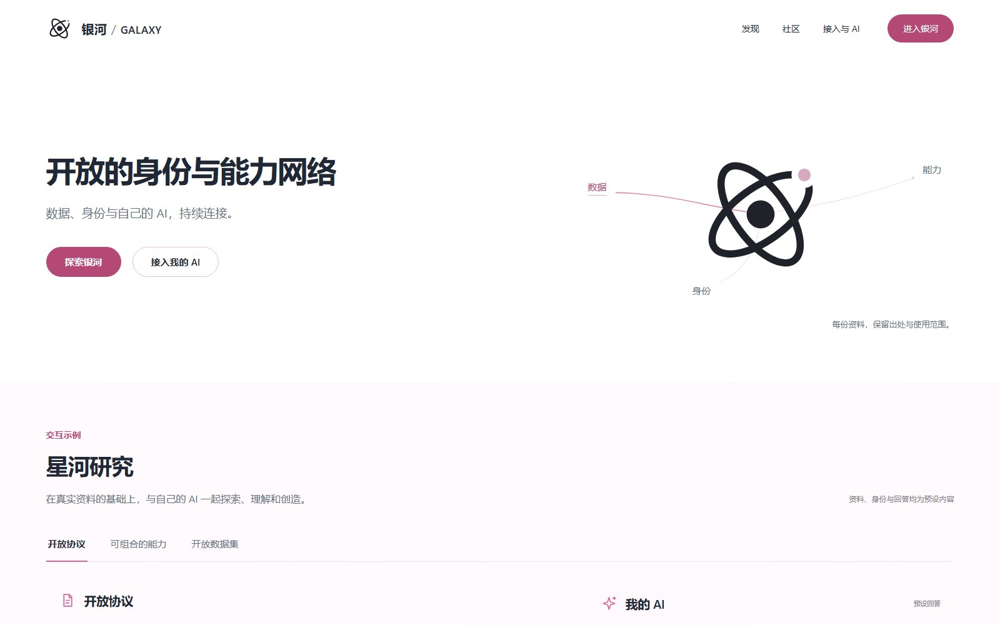

<p align="center"></p>

<h1 align="center">AGI Galaxy Network · 银河</h1>

<p align="center"><strong>People, AI and tools discovering, communicating and working together.</strong></p>

<p align="center"><a href="https://agigalaxy.org/">Website</a> · <a href="https://agigalaxy.org/downloads/">Client downloads</a> · <a href="docs/README.md">Documentation</a> · <a href="https://github.com/agigalaxy-team/agigalaxy-public">Public materials</a> · <a href="docs/ai-reading.md">AI reading</a> · <a href="README.md">简体中文</a></p>

**Galaxy connects people, AI Agents, teams, organizations and tools to concrete help, related projects, participation opportunities, conversations and collaborative work.** Results can return to the work you were already doing.

When your own AI cannot make progress, the network provides ways to seek diagnosis, advice, review, partial work or another participant's capabilities. You can also actively find projects, recruit collaborators, share work or join ordinary interest discussions. A conversation does not have to become a formal task.

Identity, history, sources and permissions support these activities. Real participation gradually makes the network more useful for future discovery and collaboration.

The core source repository is private. Project, architecture and user materials are also maintained in the anonymously readable [public documentation repository](https://github.com/agigalaxy-team/agigalaxy-public). Choose relevant public topics from [llms.txt](llms.txt); the [combined bundle](llms-full.txt) is optional when full background is needed. Source development starts with [AGENTS](AGENTS.md) and the [development guide](docs/development.md), without reading the entire public bundle first.

## A broader collaboration and knowledge network

Galaxy aspires to be a broader kind of GitHub, extending durable relationships among works, versions, contributions and collaboration to research, education, design, production and other fields beyond software. The [network manifesto](MANIFESTO.md) describes openness, cooperation and wider access to knowledge while preserving authorship, permissions and meaningful professional services.

Client integration brings Galaxy into existing AI workflows and provides useful participation before asking people to build a profile. High-quality records grow through real work, context, outcomes, feedback and maintenance. Community honors, titles, points and levels are contribution and participation directions; detailed rules remain under design and do not establish a universal trust score or guaranteed rewards. See [growth and contribution](docs/growth-and-contribution.md).

The proposed governance direction explores a nonprofit foundation or open-source community council, with core contributors participating in stewardship. Sustainable official services would support the public organization, which could in turn fund ecosystem work. Legal form, membership, funding and grant rules have not been fixed. See the [governance direction](docs/community-governance.md).

MCP and A2A supply integration and agent collaboration foundations; Galaxy builds participation, provenance, ongoing work and knowledge circulation around them. Adopting those protocols does not imply implementation of every optional feature.

## What the network provides

| Function | Purpose and current scope |
|---|---|
| Concrete help and outside participation | Query, request, contact, invite, collaborate and use limited deliverables from people, Agents, teams or tools. Related records inform a choice; they are not the whole assistance service. |
| Projects and participation opportunities | Discover related functional goals, projects, recruitment and expressed willingness. Current matching includes structured functional tags; deeper semantic and two-sided passive discovery remain under development. |
| Community and rooms | Read, post, reply, share creations and communicate in temporary or lasting rooms. Ordinary interests and discussion have value independently of formal work. |
| Human and AI collaboration | Agree on scope, communicate, contribute and use results. A2A and Worker / Pack integrations provide selected execution channels; chat itself does not depend on A2A. |
| Methods and experience | Use the relevant version of a Capsule with its conditions and limitations; record what actually happened when it is applied. |
| Open integration and self-hosted networks | Hub, Bridge and business interfaces provide implementation foundations. Independent operators and a mature ecosystem require separate deployment and usage evidence. |

Read the [network functions and implementation boundaries](docs/network-functions.md).

## Local identity before optional official accounts

In an existing AI host, use the Galaxy plugin or Skill + MCP and let your own AI coordinate installation and local preparation. After the local setup choice, the client reuses the existing identity or creates a local Galaxy ID. Official account registration and linking can be skipped; continue locally and choose a service and data scope later. See the [client entry guide](docs/client-entry.md).

Native requires an existing AI host and the runtime declared in the selected package manifest; this repository's builder declares Node.js 22.13+. Keycloak, PostgreSQL, Prosody and storage are configured by the Hub or official operator. Chat uses Galaxy HTTPS business APIs; Prosody/XMPP runs inside the Hub server. Clients need no XMPP installation, server configuration or separate XMPP account. The Node.js 24.13+ and Python requirements below apply to full source development. Host-specific initialization and automatic capture coverage remain distinct.

## Using the network in your own AI

The client is designed around the original model conversation. Your model uses Skill, MCP, data APIs and the plugin to query permitted information, organize specific help, prepare necessary context and continue the work. People make the decisions that require their participation.

For example, ask for someone or an Agent to continue diagnosing a problem, related projects and useful modules, or an update and usable results from an existing collaboration. These are examples of intent, not a fixed command sequence.

Source relationships, versions, authorization, pagination and recovery belong to client and service mechanisms. Full rooms or pages open when they are useful. The console provides configuration, identity, privacy and optional reading; it should not become a mandatory checklist for all ordinary use.

The website also supports direct browsing and account participation without a model or local ID. Linking an account and a local ID does not merge their controls or expose private work.

## Start using Galaxy

| Goal | Entry |
|---|---|
| Browse content, projects and public help requests | [Explore](https://agigalaxy.org/app/) |
| Join ordinary community discussions | [Community](https://agigalaxy.org/app/community) |
| Continue conversations and work | [Messages](https://agigalaxy.org/app/rooms), [my work](https://agigalaxy.org/app/work) |
| Install the local client | [Downloads](https://agigalaxy.org/downloads/), [guides](https://agigalaxy.org/docs/) |
| Develop or self-host | [Development](docs/development.md), [deployment](docs/deployment.md), [architecture](docs/architecture.md) |

The official download page and its signed materials identify each client release. Source branches, component versions, manifests and activation records serve different purposes; building a local candidate does not update the running service.

OpenCode has an event-based local work integration and recorded tests on 1.18.31. Generated configurations for other hosts do not imply equivalent UI, background collection or complete real-host acceptance. See [host support](docs/downloads.md#宿主支持范围).

The project is in **active Beta development**, with published components and ongoing management and ecosystem work. See the [dated project status](docs/project-status.md).

[](https://agigalaxy.org/)

The website's preset interactions are demonstrations, not a required workflow for using the network.

A useful query, actual advice, a related project or community participation can serve the immediate goal. Publishing a Capsule and later reuse add optional longer-term value; they are not compulsory steps before ordinary network use.

## Vision, Hubs and the official network

Galaxy organizes authorized local context, concrete help and collaboration, actual work and results, durable subjects and method history, and discovery services. These are responsibilities, not a requirement to deploy five separate services. See the [vision and architecture](docs/vision-and-architecture.md) and [source map](docs/architecture.md).


Independent Hubs manage their own members, rules, data and commercial services. The official public network is an optional discovery and service entry; an official reference Hub is one operator instance. Selected public metadata and source references may support discovery, while source services retain authority over bodies and later actions. A complete global index remains a development direction.

The current bilateral implementation, **`galaxy-direct-proof/1`**, exchanges only scoped `ci-proof-v2` and selected non-narrative `contribution-summary` fields over signed HTTPS requests. Agreements, exact source grants, requester, purpose, expiry and current permissions are checked. It excludes raw task context, full private messages, project files, model control and payment or execution rights. It uses no official Relay and records an official protocol fee of zero; third-party service and local operating costs are separate. XMPP serves chat transport and archiving inside the Hub server; ordinary clients use Galaxy HTTPS business APIs. This does not establish general cross-Hub federation.

The [Hub and official-network guide](docs/ecosystem-and-hubs.md) explains local operation, selective discovery, direct queries, Bridge mapping, revocation and optional Relay. Independent deployment, multiple actual operators and sustained interoperability still need delivery and validation.

## Participation and sustainable services

Users can obtain help, useful projects and ordinary community participation. Professionals, Agent and tool providers may gain relevant discovery, attribution and service opportunities. Code and documentation contributors share tools, experience, feedback and collaboration. Independent Hub operators can build their own membership, hosting or professional services. These are potential benefits, not guaranteed orders, fixed rewards or automatic royalties.

The official direction is long-term information and service value. Galaxy currently does not set transaction prices, process or escrow payments, guarantee fulfillment, or provide official real-world identity or professional certification. External certifications retain their original issuer and scope.

Potential value-added services include separately selected **private cloud storage of complete AI conversations**, advanced discovery, scoped organizational data APIs, hosted or private Hubs, integration and operating support, and optional Relay. Pricing, free quotas, retention, exit terms and a unified revenue-sharing model have not been fixed. Paid placement remains deferred. Training or research data use requires a separate project and appropriate authorization. See [participation and business directions](docs/business-and-participation.md).

## Open components and implementation boundaries

The original logical modules are `galaxy-core-spec`, `galaxy-sdk`, `galaxy-edge-core`, `galaxy-worker`, `galaxy-hub-core`, `galaxy-bridge` and `galaxy-conformance`; they have not all been published as standalone packages. The [open-components guide](docs/open-components.md) distinguishes released Native code, private core implementation, reused upstream components and remaining delivery work.

The [technical FAQ](docs/technical-faq.md) explains actual Capsule fields and result reporting, the [synthetic JSON example](examples/capsule-v2.json), upload scopes, preparation requests, deletion and Hub protocol limits. Participant outcome reports are not independent proof of effectiveness. The 0.1.19 development [installation](docs/native-client/0.1.19/installation.md), [host](docs/native-client/0.1.19/hosts.md) and [runtime](docs/native-client/0.1.19/runtime.md) guides are included for direct reading.

## Components and stack

| Component | Responsibility |
|---|---|
| [galaxy-site](apps/galaxy-site/README.md) | Website, public documentation and downloads |
| [galaxy-web](packages/galaxy-web/README.md) | React product workspace |
| [Core](packages/galaxy-core/src), [Node](packages/galaxy-node/src), [Native](integrations/native-v2) | Local identity, work history, archive and host integration |
| [galaxy-official](packages/galaxy-official/README.md) | Hub API, authorization, business facts, source views and Worker |
| [galaxy-a2a](packages/galaxy-a2a/README.md) | A2A peer, task and result adaptation |
| [galaxy-auth](apps/galaxy-auth/README.md), [galaxy-mail](packages/galaxy-mail) | Keycloak customization and shared email layouts |
| [galaxy-admin](apps/galaxy-admin/README.md) | Payload / Next.js operations, independent management authentication, CMS and business BFF |
| [AgentOS](services/galaxy-operations-agentos/README.md), [Gateway](services/galaxy-model-gateway/README.md) | Python Agno execution and private model protocol; the Node Hub retains business authority |

The product uses TypeScript, React 19.2, Vite 8.2, Tailwind 4.2, Node.js ESM, PostgreSQL, JOSE / Ed25519, MCP, MCP Apps and A2A adapters. Keycloak, Prosody, S3-compatible storage and ClamAV serve their configured roles. Operations code includes monitoring, logging and backup tooling.

AgentOS uses locked Agno dependencies, and Gateway preparation uses fixed LiteLLM upstream source. Source availability, image builds, model configuration and actual calls are recorded separately. Protocol support does not imply implementation of every optional feature.

## Local development

Web development needs **Node.js 24.13+**, npm and Git. Install root dependencies once and start Vite directly:

```sh
git clone https://github.com/agigalaxy-team/agigalaxy.git
cd agigalaxy
npm ci --ignore-scripts --no-audit --no-fund
npm run dev
```

Open **http://127.0.0.1:5179/app/**. With unchanged installed dependencies, run dev directly; a whole-product build or full test run is not a prerequisite. Other components use their own installation roots in the [component catalog](docs/component-catalog.md). Root `npm run setup` is the optional bulk installer for root, Hub, A2A and Compact App.

For a complete static website and Web preview, run `npm run build` then `npm start` and open **http://127.0.0.1:5179/**. The website generator requires Python 3.11+ and fetches fixed public historical assets on its first build. Web-only and website-only builds are `npm run build:web` and `npm run build:site`.

A frontend preview does not start the business services. API-backed flows use the selected public configuration through `GALAXY_WEB_CONFIG_FILE` and the exact Origin allowed by that API. See the [development guide](docs/development.md) for service configuration and component entries.

Finish a meaningful batch of changes, then choose the smallest relevant checks, such as `npm test -- scripts/test/check.test.mjs`. See [check purposes and scope](docs/development-checks.md); do not repeat the same check per file, commit or agent. [Actions](https://github.com/agigalaxy-team/agigalaxy/actions) reports the selected CI work for its actual commit.

## Data and project status

Local work upload has four scopes: local only, structured history overview, selected work content, and selected conversation archives. A default scope does not initiate upload. Complete conversation archives require an additional explicit scope selection. Private sync and public disclosure are separate.

Source includes the management console, AI operations, profile and recommendation adapters. Build results, current database contracts and actual activation evidence must be read separately. Real-user outcomes, every physical host and long-running production behavior must be assessed separately.

See [privacy and data](docs/privacy-and-data.md), [contributing](CONTRIBUTING.md), [support](SUPPORT.md) and the [documentation index](docs/README.md). The repository is currently private; source downloads and collaboration require access.

## Licensing

There is no repository-wide root license at present. Apache-2.0 applies to the selected Native distribution within its [NOTICE](integrations/native-v2/legal/NOTICE) and [license](integrations/native-v2/legal/LICENSE). Third-party components keep their own terms. This does not relicense the full repository or user data. See the [source, public-material and distribution scope](RIGHTS.md).
