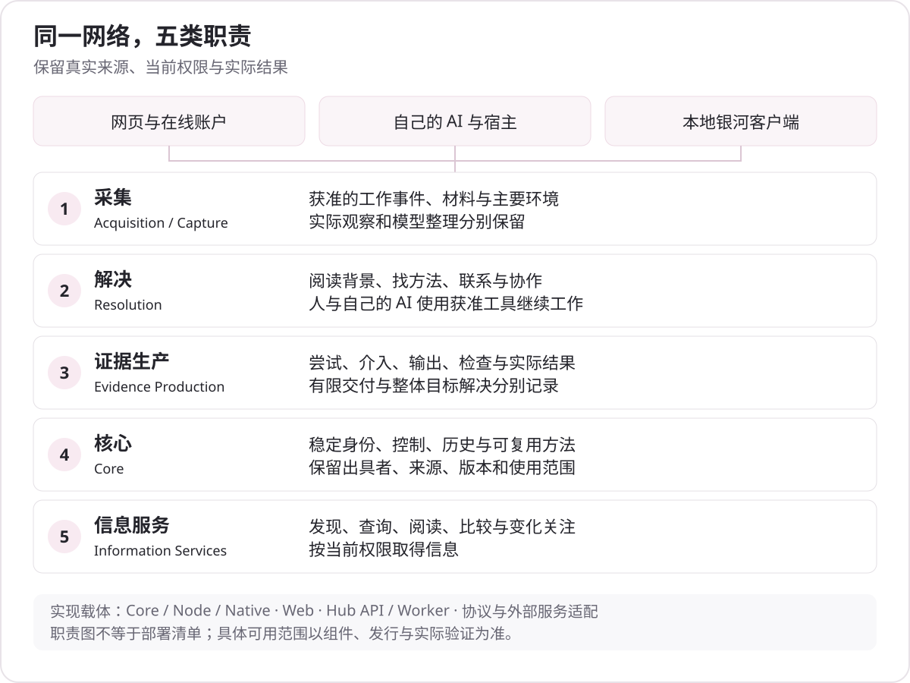
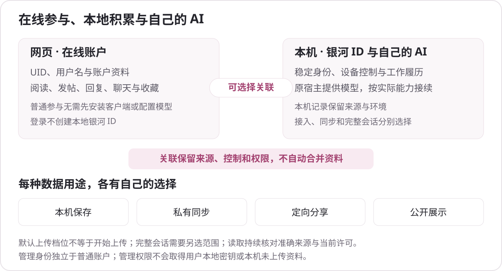

# 架构与源码地图

[文档目录](README.md) · [项目概览](project-overview.md) · [部署](deployment.md)

银河提供具体帮助、项目发现、交流与协作等[网络功能](network-functions.md)，这些功能由客户端、服务和外部参与者共同完成。

银河保留五层职责：采集、解决、证据生产、核心、信息服务。它们描述数据与工作的关系，不对应五个强制独立的服务，也不表示每层已经具有完整生产覆盖。

## 五层职责

| 职责 | 处理什么 | 对应实现位置 |
|---|---|---|
| Acquisition / Capture | 获准工作中的目标、文字与工具观察、有限片段、环境变化及来源 | [本地工作记录](../packages/galaxy-core/src/work-history)、[Native](../integrations/native-v2)、[宿主适配](../integrations/host-adapters) |
| Resolution | 阅读背景、寻找方法或参与者、联系、使用工具及继续原工作 | [产品网页](../packages/galaxy-web/src)、[本地客户端](../packages/galaxy-node/src)、[A2A](../packages/galaxy-a2a/src) |
| Evidence Production | 实际尝试、介入、输出、有限结果、更正、检查和解决情况 | [核心领域](../packages/galaxy-core/src/domain)、[业务服务](../packages/galaxy-official/src)、[API 目录](development-api-reference-v1.md) |
| Core | 稳定身份、主体控制、声明、历史、外部凭据、有限认可与 Capsule 方法 | [Core](../packages/galaxy-core/src)、[Node](../packages/galaxy-node/src)、[Official](../packages/galaxy-official/src) |
| Information Services | 按当前权限发现、检索、读取、比较与关注变化 | [业务服务](../packages/galaxy-official/src)、[发现与查询界面](../packages/galaxy-web/src)、[MCP 接入](../packages/galaxy-edge-mcp/src) |

工作事实可包含 Case、Attempt、Result、Revision、Withdrawal 等版本化对象。普通用户不必为每次聊天手工补齐这些对象；界面按真实使用目的组织，后台维持事实与权限关系。

## 运行组件

- **网站。** `apps/galaxy-site` 生成官网、公开指南和下载页面；`packages/galaxy-web` 是当前业务网页。公开非首页内容可由同一 React 工作区渐进接管，保留静态阅读回退。
- **本机。** `galaxy-core`、`galaxy-node` 和 Native 保存本机身份、工作记录、会话与必要操作记录。用户模型留在宿主中，支持范围取决于实际宿主接口。
- **Hub。** `galaxy-official` 提供 HTTP 业务服务、数据库操作、权限检查、来源投影与 Worker。PostgreSQL 保存业务状态；迁移和运行角色分开。
- **服务端外部依赖。** Keycloak 负责账户认证；Prosody / XMPP 在 Hub 服务器内部处理消息传输与归档；对象存储与扫描器处理文件。普通客户端通过银河 HTTPS 业务接口使用聊天，无需安装、配置 XMPP 或单独注册 XMPP 账户。银河负责相应业务授权，不能由存储 URL 或聊天成员关系替代全部来源检查。
- **管理端。** `apps/galaxy-admin` 使用独立管理身份域和独立 CMS 数据库。官网内容进入 CMS，业务事实继续通过银河 API 处理；不由 CMS 直接修改业务表。
- **运行工具。** Caddy、systemd、Docker Compose 及监控、日志、备份工具位于部署与运行目录。准备脚本、配置或构建存在，不说明目标环境已经启动或恢复成功。

## 身份、授权与持久化

在线账户 Cookie、客户端设备签名、连接范围、内容使用许可和管理员角色分别核对。账户关联不合并本地 ID，登录不自动证明本机控制，管理权限不获取用户密钥。

读取受控正文时重新检查准确来源、版本、受众和期限。结果未知时沿原 operationId 查询和接续，不能通过生成新请求猜测是否成功。后续权限变化仍可使旧预览或读取失效。

数据库迁移是显式部署步骤，API 启动不会自动修改 schema。业务数据库、CMS 数据库、身份服务数据、本地客户端目录与对象存储各自持久保存，整站恢复需要协调它们的时间与关系。

## 协议与角色

HTTP、MCP、MCP Apps 和 A2A 复用相应业务含义。MCP Apps 是受宿主支持约束的小面板；A2A 对端报告与本地工作结果分别保留。使用 SDK 不表示实现所有协议可选项，也不替代对端身份或内容真实性判断。

Hub 是服务环境；Worker 执行获准任务；Bridge 保留外部观察来源；Federation 进行具体范围的信息交换。Relay / Directory 等架构角色按实际组件和服务声明使用，不能从角色名称推定已有跨组织生产网络。

## 源码入口

| 目的 | 文件或目录 |
|---|---|
| 产品页面与路由 | [main.tsx](../packages/galaxy-web/src/main.tsx) |
| 共享网站、认证品牌与导航 | [site-chrome.mjs](../packages/galaxy-web/src/site-chrome.mjs)、[网站界面](site-ui.md) |
| API 启动与实际配置读取 | [server.mjs](../packages/galaxy-official/src/server.mjs) |
| Worker | [worker.mjs](../packages/galaxy-official/src/worker.mjs) |
| 数据库与迁移 | [database.mjs](../packages/galaxy-official/src/database.mjs)、[migrations.mjs](../packages/galaxy-official/src/infrastructure/migrations.mjs) |
| API 工具与接口目录 | [开发 API 说明](development-api-reference-v1.md) |
| 统一前端构建与预览 | [build-product.mjs](../scripts/build-product.mjs)、[serve-product.mjs](../scripts/serve-product.mjs) |
| 认证与共享邮件 | [认证](../apps/galaxy-auth/README.md)、[邮件](../packages/galaxy-mail) |
| 管理应用与配置 | [运营后台](../apps/galaxy-admin/README.md) |

根目录 `app/` 与相应 demo 脚本保留早期演示用途。当前生产网页不能从该目录推断，完整服务也不能由前端预览端口推断。

## Hub 和官方之间的信息流

Hub 内部数据按本地业务和来源许可处理。选择性公共发现只提供允许的元数据、摘要与引用，不让官方自动取得所有正文。当前 `galaxy-direct-proof/1` 为双边 HTTPS 签名查询，只交换获准 `ci-proof-v2` 和选定非叙述贡献字段；不是全站资料复制，也不是 XMPP 聊天联邦。

角色、协议协商、逐来源授权、请求与返回、后续联系、Bridge、撤回和可选 Relay 见 [Hub 与官方的运作](ecosystem-and-hubs.md)。原始模块职责与当前开源复用见[开放组件](open-components.md)，Capsule 与上传流程的具体字段和边界见[实现核对](technical-faq.md)。
