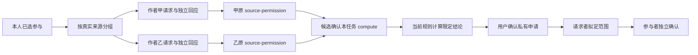

# M11 逐作者资格许可收集与旧材料选择

这是 `NEW-M11-FLOW-PARTICIPATION` 的网页与真实业务补齐，使用迁移66。用户问题和来源发展见项目 `07-logs/development/bounty-web-v2.md`。依据为 M11 完整阅读包/工作包、卷08 B-08-Q04 的当前相关实际经历、B-08-Q05 的人工选择、CUR28 的逐对象独立联系、CUR29 的各自明确确认，以及卷12的分阶段披露、撤销与本人删除。请求表、29天上限和24小时冷却是本次必要技术细化，不能转述为用户原话或永久资格等级。

## 用户流程和权限

申请者在任务页选择本人当前实际参与，读取原作者清单。服务沿真实已接受的参与、交付、Case 根、Result/介入来源及相关 Task 事件，取得精确版本和原始载荷摘要，再按实际作者分组；调用者不能指定假的作者、替换版本摘要或把任意引用加入请求。多人协作的各作者分别处理，不创建共同公开房间，也不要求参与或主动任务预先存在失败史。

每位作者收到的请求仅包含自己被选中的来源。服务重新判断作者当前能否读取目标 Task：不能读时，页面只说明明确任务标识、用途、候选人与结论接收者，不泄露任务标题、私有条件或其他来源作者的信息。作者可以暂不处理、拒绝或另行授予限定许可。没有收到请求或没有历史的新参与者仍可使用开放协助。

作者同意使用现有 `qualification.source-permission` 写入自己的精确授权，不借请求改变原材料可见性。随后独立记录“关联已授出许可”的回应；丢回执后可从本人已授出许可目录恢复，主要流程不要求粘贴 ID。候选人在所需作者均给出当前许可后，明确确认原 `qualification.compute`。最终资格计算继续使用当前 Task 规则和原事实；资料缺失、非实际资料或来源撤销不能被“请求已回应”覆盖。

请求、许可、计算、满足资格和实际承接分别成立。候选取消请求不会撤销作者已经独立授出的许可；作者可从自己的许可清单另行撤销。原许可、原来源 Consent 或材料失效时，读取/计算重新核对并停止使用；收据不能恢复正文。一次授权只绑定当前任务、候选人、请求者、用途、准确来源集合与截止，不用于公开履历、Capsule、信任包或其他任务。

本收集器使用已有计算服务支持的 Case/Task 事件授权。Evidence、配置正文、外部审核和 CI 的原有独立权限不被它替代；含这些依赖的参与仍需原 reader 当前允许读取。清单“许可齐全”只描述本轮所需原作者许可，最终计算保留不足或不可用结果。银河不会承担模型解释、反复尝试或自行批准工作。

## 旧资格资料

`/v2/qualification/candidates` 增加 `kind=legacy-assistance`，只列当前身份本人被选择提供者的现存合法旧协助，并调用原 reader 过滤当前可见性和相关能力。v2 Task 的合法旧资格 profile 以未填 `profile` 表达，网页保留这一字段形状；不发明 `legacy-v1` 值。申请仅填写旧 `proofIds` / `assistanceIds`，核对走原 `/v1/qualification/evaluate`。新 Participation 不转成旧 Assistance；原旧对象也不改成 v2 Task。原 v1 业务保留原 API。

计算授权是固定的证据集合。网页选择该项时单独使用，不把其他勾选项静默混入旧签名范围；计算完成仅加入本地申请材料，仍需用户单独确认申请。

## HTTP、MCP 与同事务边界

所有下列接口要求当前登录及 `assistance` scope；写接口必须提供已经签署的 `{consentId,payloadJson}`，服务重新核对原始正文和 Consent。没有额外伪造的模型确认字段。

| POST 路径 | 服务方法 / 输入要点 |
|---|---|
| `/v2/qualification/permission-requests/plan` | `qualificationRequests.plan`，Task、本人 Participation IDs、明确截止 |
| `/v2/qualification/permission-requests/events` | `submit`；request / decline / cancel / record-permission 的精确私有事件 |
| `/v2/qualification/permission-requests/read` | `read({requestId})`；候选或该作者本人当前视图 |
| `/v2/qualification/permission-requests/query` | `query({view:sent|received,taskId?,after?,limit?})` |
| `/v2/qualification/permission-requests/receipt` | `receipt({eventId,payloadHash})`；仅提交者精确回执 |
| `/v2/qualification/calculation-owned` | `qualificationCalculations.owned`；本人原许可/计算意图与撤销入口 |
| `/v2/qualification/calculation-receipt` | `receipt({operationId,payloadHash})`；原许可、计算或撤销回执 |

原 `/v2/qualification/calculation-permissions` 和 `/v2/qualification/evaluate` 不变。`qualificationRequests.planWithin/readWithin` 供同事务授权和通知使用。原作者通知由当前 request reader 再过滤，普通举报、通知已读或 request 本身均不变成授权。

MCP canonical 工厂为 `personal-mcp-qualification-v2.mjs`。新增 request plan/submit/query/read/receipt 和 calculation owned/receipt 七个工具；原五工具保留。原生 HTTP 代理由对应适配器复用 canonical 形状；部署/实际宿主支持状态另记，不以工具定义存在宣称上线。

## 数据、保留与重试

迁移66仅追加两张表和通知已读 kind 约束扩展，旧1—65不改写。`qualification_permission_requests.subject_id` 是候选拥有的协调元数据；`qualification_permission_request_events.subject_id` 是每一事件独立作者。原作者回应的外键可以保留一个无候选正文的请求容器，删除候选不能删掉另一作者的独立回应。

请求最长29天，适配现有授权有效期。新请求同候选、同作者、同任务至少间隔24小时；上一请求未回应且未到期还会继续阻止另发。即使先填极短期限或取消，也不能绕过24小时。完全相同的原操作重试先核对精确回执，不算新请求。该冷却仅是私有许可协调的反骚扰约束，不是遇阻机制的固定模型重试次数。

到签署的请求截止，read 立即返回到期最小状态，worker 清除该请求各事件正文并登记原 hash 的擦除事实。回执在请求截止后180天清理；这是临时协调/最小操作核验的技术保留窗口，不替换业务治理结案后180天规则。原独立 source-permission/compute 使用原有生命周期。本人的数据导出包含本人请求元数据和自己撰写的事件；不会复制他人的响应正文。实际删除按事件作者处理，不能用父请求的归属删除他人内容。

网页操作日志按 endpoint / subject / qualification 家族隔离。先持久原事件、原内容和签名，再发网络。丢 Consent 或业务 ACK 后先查各自精确回执；已接受的签名和业务 ID 不被新草稿覆盖。只有原业务和原授权均不存在、且原授权无法用于当前绑定/期限时，用户审阅相同内容后才可重新授权同一业务 ID。停止本机重试只清本机重试材料并保留最小核对项，不能宣称服务端取消；已记录请求另发 cancel，已有许可另发 revoke。

## 组件和运行前检查

- `QualificationPermissionWorkspace({runtime,subjectId,connected,navigate,initialRequestId?,onNeedIdentity?})`：独立页面 `/app/qualification-permissions` 及精确请求深链接。
- `QualificationPermissionCollector` 嵌入 `TaskApplication`：使用现有本机草稿、已选真实参与、原作者清单与计算授权预览。普通申请无需这条分支。
- `qualification-permission-client.mjs` 复用原 exact-operation 日志能力，`qualification-permission-operations.tsx` 提供恢复界面。TaskCollaboration 可核对现代与合法旧 profile；通知直接打开对应请求。

AI Agent 部署时先检查数据库至少66、当前资格策略与原始来源接口可用，再发布相匹配的网页/API/MCP。API只给新增表所需读写权限，worker单独获得到期清理与行锁必需的权限。发现 `qualification_request_cooldown` 时保留原请求查看回应，不重造一批 ID；`qualification_source_unavailable` 时重新读取具体来源，不把未取得正文写成合格。没有真实策略或作者许可时保留草稿和未知状态。没有模型服务、付款、备份或新远程连接配置。

## 验证范围

独立实际 HTTP/BrowserClient 签名及 PostgreSQL 受限 API/worker 用例见 `test/qualification-permission-web-v2-workflow.mjs`。覆盖旧版已接受来源、两个原作者分别许可、原作者不能读目标私有任务、请求不能代替许可、原许可与请求取消分离、拒绝、原授权撤销、精确业务回执、重连后同业务 ID 授权恢复、到期隐藏/正文清理/最小回执，以及候选删除保留独立作者回应。模拟数据只验证行为，不构成真实专家资质、报酬或运营验收；内存本机存储替身不算 IndexedDB 实测。独立浏览器视觉验收和发布状态由主代理记录。
