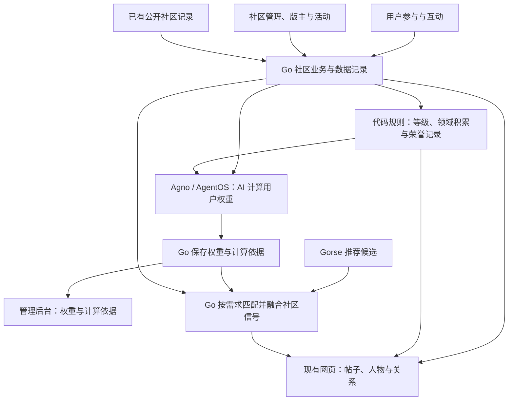

# 社区成长、信誉、权重与推荐开发设计

状态：**本轮社区成长、管理认可、权重任务及推荐参考已接通发布；计算和推荐参考保持人工开关，当前均未启用**。更新于 2026-11-06（Asia/Shanghai）。本主题只维护这一份正文；源码观察、用户决定、工程建议分别表达。

## 1. 目标、已确认方向与边界

目标是让正常社区参与形成可延续的成长与认可，由 AI 综合社区数据计算用户权重，并在适合的评价、发现和推荐场景中使用。普通用户不需要为此另外登记成果、创建正式任务或完成证明流程。

| ID | 关键取舍 | 候选与当前建议 |
|---|---|---|
| D01 | 成长呈现（已确认 A） | 社区等级＋领域积累＋独立荣誉。用户于 2026-11-06 明确选择；不把成长自动变成后台权限。成长规则设计见第 5 节，初始分值与门槛随配置交付 |
| D02 | 权重强度与作用面（已确认 A） | 内容与需求匹配为主，信誉和领域积累按领域与用途提供有限但明确的辅助影响。用户于 2026-11-06 明确选择；第 6—7 节给出计算与应用设计，参数集中配置 |
| D03 | 公开社交关系（已确认 A） | 增加可选择的公开关注与关系展示，呈现公开范围内的关注／粉丝信息；已有私人关注保持私人。用户于 2026-11-06 明确选择；复用现有关注服务，支持公开／私人切换与公开关系列表 |
| D04 | 等级／荣誉权益（已确认 A） | 本轮用于成长展示、认可及已选定的发现／推荐参考，不新增按等级或荣誉解锁功能的机制。用户于 2026-11-06 明确选择；保留现有功能和阅读条件，不自动授予后台权限 |
| D05 | 是否需要可消费积分（已确认 A） | 本轮不做可消费积分，先完成等级、领域积累、荣誉和关系展示。用户于 2026-11-06 明确选择；不影响设计用于展示成长进展的经验值 |
| D06 | 社区数据与 AI 权重计算（已确认方向） | 数据由代码规则、社区管理、版主、活动等途径形成，AI 根据这些数据计算用户权重。用户于 2026-11-06 明确职责；第 6 节给出材料、尺度与结果更新方案，模型实际表现仍需验证 |
| D07 | 社区积累归属（已确认 A） | 等级、领域积累和新权重由网站社区账户承载，人物页集中展示；关联银河 ID、组织或 Agent 保留各自来源，原 ID 和历史记录保留。用户于 2026-11-06 明确选择；旧身份荣誉按当前公开关联独立展示 |
| D08 | 已有社区积累承接（已确认 A） | 已有贡献也纳入，延续积累：采用能准确归属且符合条件的既有公开帖子、回复、公开荣誉及相应社区记录，缺失信息不补造；私人关注、收藏、私聊及分析专用数据维持原用途。用户于 2026-11-06 经解释后明确选择 |

2026-11-06 已追加确认以下使用选择，覆盖后文相应工程默认：

| ID | 已确认选择 | 具体效果 |
|---|---|---|
| P01 | B：新关注默认公开，可改为私人 | 旧私人关注保持私人；首次建立的新关系默认公开，不每次弹窗确认 |
| P02 | C：权重仅供管理者查看 | 前台及本人普通账户页面不额外展示 AI 权重数值、表现标签或计算依据；原等级、领域积累与荣誉继续展示 |
| P03 | A：点赞和取消点赞 | 帖子与回复本轮不新增反对按钮；原评论、收藏和举报保留 |

上述选择确定产品方向和本轮使用方式，普通技术取舍由开发完成；其他实际新增业务形式不能凭技术实现顺带扩展。

- 社区以现有帖子、回复、人物、分类和主题为基础；允许站外与 A2A 合作，不由平台替参与者安排劳动过程。
- 本机经验由用户侧宿主模型择优整理；本机保存、上传、公开发表分别成立，不为计分自动创建 Capsule。普通经验帖与正式 Capsule 保持原有区别。
- 不新增可消费积分、等级权益解锁、认证平台、推荐平台或独立社区微服务。原 ID、UID、GUID、绑定与历史归属保持。
- 公开关注可由用户选择；旧私人关注、收藏、私聊、本机未上传资料、举报取证及通知数据保持原用途。既有公开社区积累按 D08 承接。
- 社区数据由代码规则、社区管理、版主、活动等正常途径形成；AI 负责据此计算用户权重。AI 不在本设计中接管荣誉授予，不自行改模型、提示词和授权。

## 2. 原有基础与当前源码入口

下表保留方案研究时对原有基础的观察，不代表当前新增代码缺失。当前实现见 [communitygrowth](../../go/internal/communitygrowth)、[API 装配](../../go/cmd/galaxy-api/community-growth.go)、[Worker 装配](../../go/internal/workerconfig/community-growth.go)、[论坛互动](../../go/internal/community/reactions.go)、[关注关系](../../go/internal/accountsocial/follows.go)和[社区推荐融合](../../go/internal/discovery/community-ranking.go)。这些源码入口不证明线上已启用或模型效果已验证。

| 范围 | 已观察到的实现 | 可复用入口与实际限制 |
|---|---|---|
| 账户与主体 | 账户资料包含 person、organization、agent；账户、UID、银河 ID 与关联各有职责 | [accounts/profile.go](../../go/internal/accounts/profile.go)、[身份产品](../product/identity.md)。社区账户与 ID 荣誉不是同一个主键，不能直接混算 |
| 社区内容 | 帖子、回复、版本、分类、举报、权限与原操作回执 | [community/http.go](../../go/internal/community/http.go)、[community/write.go](../../go/internal/community/write.go)。本次检查的路由与事件合同中未发现完整点赞投票、成长等级与声誉加权链路 |
| 社交与收藏 | 私人关注关系、私有收藏及对应操作记录 | [accountsocial/service.go](../../go/internal/accountsocial/service.go)、[follows.go](../../go/internal/accountsocial/follows.go)、[bookmarks.go](../../go/internal/accountsocial/bookmarks.go)。不能直接公开旧关注、粉丝列表或私人收藏 |
| 贡献公开 | 对已有 Task／Case 事件的选择性贡献投影、发表与撤销 | [contributions/service.go](../../go/internal/contributions/service.go)、[source.go](../../go/internal/contributions/source.go)。当前源类型有限，不是所有帖子、作品和经验的通用贡献服务 |
| 荣誉与有限排名 | 规则版本、有限来源投影、状态重算及范围内排名 | [honor/service.go](../../go/internal/honor/service.go)、[registry.go](../../go/internal/honor/registry.go)、[v2.go](../../go/internal/honor/v2.go)。当前没有通用可编辑授奖账本；排名主要按指定规则范围的已接纳事项计数，不是全社区能力榜 |
| 贡献风险线索 | 重复来源、关联和部分异常聚合 | [honor/risk.go](../../go/internal/honor/risk.go)。明确是复查线索，不代表判定造假，也不自动处罚；其中旧阈值不是本候选的既定参数 |
| 资料展示 | 人物页与贡献认可读取 | [person-recognitions.tsx](../../packages/galaxy-web/src/features/profiles/person-recognitions.tsx)、[person-recognition-view.mjs](../../packages/galaxy-web/src/features/profiles/person-recognition-view.mjs)。可扩展已有展示，不必重做外壳 |
| 使用与主题分析 | 曝光、阅读、点击、收藏、参与、搜索、不感兴趣等事件；主题汇总 | [discovery/events.go](../../go/internal/discovery/events.go)、[operationsanalytics/profile.go](../../go/internal/operationsanalytics/profile.go)。这些事件有既定用途，不是可以任意转用的公开信用事实；画像需求也不等于预测全链路已经交付 |
| 推荐 | Gorse 候选、反馈投递、当前资格过滤、主题调控及防重复／集中配置 | [discovery/gorse.go](../../go/internal/discovery/gorse.go)、[recommendation-control.go](../../go/internal/discovery/recommendation-control.go)、[recommendation-commands.go](../../go/internal/discovery/recommendation-commands.go)。当前适配反馈值为 1，不是按评价人信誉加权；能力存在不表示每项配置已启用 |
| 本机经验 | 私有经验查询、修订、形成依据及宿主整理 | [native/work-experience-tools.go](../../go/internal/native/work-experience-tools.go)、[共用整理提示](../../integrations/host-adapters/shared/local-work-review.mjs)。不自动发表或创建 Capsule，也不自动给公开账户加分 |
| AI 与执行 | 稳定 AI 身份、任务、策略、操作卡、权限和审计；推荐等已有动作 | [operationsautonomy](../../go/internal/operationsautonomy/model.go)、[agentos/actions/recommendation.go](../../go/internal/agentos/actions/recommendation.go)、[agent-runtime.md](agent-runtime.md)。本功能的社区数据接入、AI 权重计算和结果应用仍需按最终设计实现，不能仅修改提示词冒充接通 |


## 3. 研究结论与采用方式

本次重点核查以下开源项目的相关源码，固定到所列提交；不是这些项目的全面审计，也不是对其运行效果的保证。采用机制设计，不引入整套论坛、额外数据库或上述项目的运行依赖。

| 来源与固定源码 | 核查到的机制 | 银河采用方式与不照搬部分 |
|---|---|---|
| Discourse：`5d78f59199c5`；[Promotion](https://github.com/discourse/discourse/blob/5d78f59199c5b911016ab32ad69dc438b2466256/lib/promotion.rb)、[BadgeGranter](https://github.com/discourse/discourse/blob/5d78f59199c5b911016ab32ad69dc438b2466256/app/services/badge_granter.rb)、[UserBadge](https://github.com/discourse/discourse/blob/5d78f59199c5b911016ab32ad69dc438b2466256/app/models/user_badge.rb) | 成长判断使用可配置条件；荣誉保留用户、出具者、时间及内容关联；对象变化合并后处理，授予与撤回更新相关记录 | 采用规则配置、具体认可记录、受影响对象更新与旧资料补算；不搬信任等级的功能限制、原阈值、SQL 脚本配置或权限解锁 |
| Apache Answer：`6744295fa888`；[投票服务](https://github.com/apache/answer/blob/6744295fa888e0621fc9f9a8ace04f1a4daf8554/internal/service/content/vote_service.go)、[投票持久化](https://github.com/apache/answer/blob/6744295fa888e0621fc9f9a8ace04f1a4daf8554/internal/repo/activity/vote_repo.go)、[行为记录](https://github.com/apache/answer/blob/6744295fa888e0621fc9f9a8ace04f1a4daf8554/internal/entity/activity_entity.go) | 投票与受益者的变化分别记录；取消操作在事务内撤销相应记录及分值；关联对象、触发者、修订与取消状态可定位 | 借鉴互动、收益和撤销的一致处理；不照搬问答采纳流程、具体声望分值、每日上限或声望解锁权限 |
| NodeBB：`2f5e2f04508a`；[votes](https://github.com/NodeBB/NodeBB/blob/2f5e2f04508a54e7ad329ad4c881a98a036c808f/src/posts/votes.js)、[rewards](https://github.com/NodeBB/NodeBB/blob/2f5e2f04508a54e7ad329ad4c881a98a036c808f/src/rewards/index.js) | 点赞状态、取消及计数相互接续；奖励由条件和动作连接，条件可配置 | 采用少量自然互动、可取消状态和条件驱动；不复制其全局 reputation 直接加减、投票门槛或插件／存储架构 |
| Community Notes：`9094f10908a3`；[helpfulness_scores](https://github.com/twitter/communitynotes/blob/9094f10908a3955765032e0450918d22739ea153/scoring/src/scoring/helpfulness_scores.py)、[计算说明](https://github.com/twitter/communitynotes/blob/9094f10908a3955765032e0450918d22739ea153/documentation/under-the-hood/contributor-scores.md) | 分开计算作者贡献和评价者表现，并使用历史评价及内容结果；所读实现是统计／矩阵分解相关计算，不是通用 LLM 用户打分模块 | 借鉴“内容贡献”和“评价参考价值”分开，不照搬事实核查场景、阵营模型、准入过滤、惩罚倍数与评分门槛，也不把多数一致当作正确 |
| Gorse：`2145bd0567f0`；[recommend](https://github.com/gorse-io/gorse/blob/2145bd0567f03b59f83f43ea2575a17a9bdaa016/logics/recommend.go)、[reranker](https://github.com/gorse-io/gorse/blob/2145bd0567f03b59f83f43ea2575a17a9bdaa016/logics/reranker.go)及[官方管线](https://gorse.io/docs/concepts/pipeline) | 候选来源、排序、缓存和回退分工明确；所读新版也有模型重排适配 | 保留银河现有 Gorse 接口，由 Go 在候选之后应用社区信号；不因新版有 LLM 重排就升级引擎或在网页请求内再调用一遍模型 |

这些实现可以支持社区基础机制的设计，但不能证明“LLM 计算跨领域用户权重”已经成熟可直接部署。该部分是银河的新增设计，需在实现阶段用有代表性的材料做有限真实模型检查。

[LLM-as-a-Judge 研究](https://arxiv.org/abs/2306.05685)讨论了顺序、篇幅和自我偏好等偏差，研究对象是模型回答评估，不是社区信誉。这里只据此安排材料组织与评分尺度，不把论文中的效果数字转作银河准确率。

## 4. 简明架构与职责



Go 管业务事实、确定性计算及结果应用；Agno／AgentOS 承担模型任务和材料理解；Gorse 承担既有推荐候选。PostgreSQL 保存所需业务与计算记录，现有网页查询和事件机制负责局部更新。权重供业务内部应用和管理端查看，不直接返回普通前台。普通打开页面不调用模型、不全库重算，也不因切页或聚焦清空内容。

## 5. 正常社区怎样使用

### 5.1 内容与互动

已确认给原帖子和回复接入点赞／取消，沿用回复、引用、收藏、举报和编辑入口；本轮不新增反对按钮。用户看到实际点赞数和本人状态，提交时就地反馈。喜欢、收藏、评论、采用与实际结果分别成立；点赞不冒充使用成功，评论不一律转成正面认可。

公开分享的作品、经验、整理、翻译、纠错与长期维护都可沿原内容进入，类型保持可扩展。转载、模型总结和跨入口引用保留共同来源，不增加独立贡献次数；补充者、纠错者与维护者可以各自留下对应记录。

互动更正和内容版本沿原对象接续。明确取消的点赞撤去对应收益；内容撤回时停止不再成立的传播和当前引用，不直接把历史荣誉一并撤销，历史认可按其自身规则和状态处理。

### 5.2 成长与领域积累

采用规则配置加成长记录，不由 AI 临时决定谁升级。规则包含适用来源、取得条件、经验值、领域关联、重复取得方式、更正处理和生效版本；界面提供实际支持的条件，不能要求管理员编写任意 SQL 或搭建一套流程语言。

首批规则建议围绕有效内容贡献、收到的认可、补充维护、社区管理认可及活动成果组织。普通参与可有适量进展，主要积累来自贡献与认可，不把发帖次数、登录或在线时长直接等同价值。具体分值和等级门槛作为初始配置交付，不固化在引擎或开发规范中。

程序从有效成长记录汇总经验，再按当前规则得到等级；规则版本变化更新对应记录，不重放原用户操作或再次发放同一收益。长期等级表达累计积累，近期活跃和当期榜单单独表达，不因暂时离开社区自动变成低信誉。

领域积累复用分类、标签和需求主题关联，可覆盖多个领域；成长总量、领域贡献和实际荣誉分别展示。新领域可以发展，不要求用户选择封闭的职业或能力目录。

### 5.3 社区管理、版主、活动与荣誉

数据来源必须有正常入口，不能只给 AI 一张待填的资料表。建议在原后台和版块管理位置接以下操作：

| 操作 | 使用方式与数据 |
|---|---|
| 维护成长规则 | 管理者编辑规则和等级配置，查看实际支持的来源及变更影响后采用 |
| 管理内容认可 | 管理者／有相应范围权限的版主对具体内容做认可、更正或撤回，记录对象、领域、理由、操作者和时间 |
| 维护荣誉 | 配置荣誉定义与取得方式；明确规则由程序产生，人工／活动认可由相应正常操作产生；具体荣誉记录可更正 |
| 记录活动结果 | 关联活动帖子／专题、真实参与者及结果，由对应管理者办理；首版接结果记录，不扩建报名、票务、钱包或完整活动平台 |
| 处理异议 | 从相关内容、认可或账户结果进入原管理操作，修正对应事实，驱动受影响计算更新 |

现有版块维护者、GUID 治理配置和后台角色有各自职责，不能直接混成一种版主身份。拟扩展的版主操作按账户和版块范围接现有授权能力，保持后台管理与普通社区身份边界；不因成长等级授予管理权限。

未核实举报不作为用户失信事实，举报私有材料不进入普通权重上下文；确有适用公开管理结论时只使用相应范围的信息。异常线索与处罚决定分开，团队、固定读者或共享网络本身不构成作弊结论。

### 5.4 公开关注、人物页与榜单

复用现有关注关系，补可见性和公共读取，不建立第二套关注服务。已有关系保持私人；已确认首次建立的新关注默认公开，用户可改为私人，不每次弹窗确认。已有记录保留其可见性，主动切换时才改变；调整可见性不等于取消再关注。公开列表和数量只对应可公开的关系，不泄露隐藏关注。独立关注内容流不由这项选择自动加入本轮。

人物页依次呈现等级与进展、领域积累、具体贡献、荣誉及公开关系，按需展开这些公开资料的依据和历史。帖子侧只放适量标识，不为每条内容铺一排分数。AI 权重仅在管理端按相应权限查看，普通前台及本人页面不新增权重表现、数值或计算依据。

公开榜单按领域、时间和对象表达实际统计口径，贡献或活跃与 AI 权重分别处理，不新增公开权重榜。没有材料或样本不足时呈现实际状态，不包装成全行业能力排名。已有 Case 范围荣誉与排名保留自身含义。

## 6. AI 怎样计算用户权重

### 6.1 一份材料基础，按用途输出

AI 读取按社区账户组织的材料，不复制成另一套身份。材料保留相关内容／版本、有效互动与时间、成长及领域记录、公开荣誉、适用的管理与活动结果、修订和已知同源关系。私人关注、收藏、私聊、未上传本机资料及分析专用数据不因聚合而转用。

程序负责准确计数与关联；AI 理解材料的意义、领域相关性和不同性质的表现。长历史由可追溯的分层汇总加按需原文读取承接，覆盖不同时间与来源，不只取最新或最热门内容，也不把汇总和原件算成两份独立依据。

首版建议保留两种用途，协议允许以后扩展，而不是把所有使用场景硬写成两个固定能力：

| 结果 | 含义 | 拟接消费者 |
|---|---|---|
| 领域贡献影响 | 根据实际贡献、认可、维护和结果，计算该账户在相应领域的影响参考 | 管理端权重详情、内容发现与推荐中的内部作者辅助信号 |
| 领域评价参考 | 根据可用的内容理解表现、相关贡献及能成立的评价记录，计算其评价对本领域内容的参考程度 | 对实际互动的内部加权聚合 |

写得多不自动表示评得准；没有评价依据时，评价参考保持普通中性，而不是直接继承贡献影响。无证据不编造“专业可靠”，普通不感兴趣也不当作他人内容有错。

### 6.2 计算方法和可比较性

采用“统一用途说明与尺度＋具体材料理解＋结构化数值结果”。工程建议使用归一化内部尺度，并为不同表现提供描述清楚的参照例子；来源不同、领域不同仍按同一用途解释尺度。范围是计算合同，不是岗位、任务轮数或通用 Agent 能力限制。

首版建议内部计算值使用 0—1 刻度，分别描述较弱、普通、较强表现的参照材料；缺少依据使用独立的“未形成判断”状态，不强行输出 0。评价聚合将有效值按策略映射成围绕普通影响的系数，无结果时采用中性系数 1。模型负责判断计算值，程序负责映射和计算实际影响；刻度及映射参数随版本配置，不作为永久业务常数。

每次结果至少表达：账户、领域、用途、计算值、材料覆盖程度、主要依据、缺项、输入版本及模型／提示词／规则版本。材料覆盖程度表达依据是否充分，不把模型自报把握当作已校准概率；缺少材料可以不出推断值，消费端采用中性影响。

AI 根据材料综合计算，程序不以固定事件加减公式替代这一步；程序负责结果解析、来源版本对应、保存及消费端换算。模型只对提供的社区资料计算，不把文章里的指令、用户自称或活动介绍当作系统计算规则。

相关提示词、模型和计算说明在现有 AI 配置体系人工维护。计算说明包括共用说明（`instructions`）和各用途说明（`purposeInstructions`）；任务保留共用说明，并只绑定当前用途对应的专属说明，不带入其他用途文本。既有人工说明不会自动改写或自动启用；管理页面以计算说明、贡献参考和评价参考呈现，不要求使用者理解字段或工具。社区规则和参数由后台对应业务配置维护，AI 不修改自己的尺度或配置。

先用少量有代表性的材料检验同尺度比较：新人高质量内容、长期普通参与、跨领域贡献、短文与长文、事实更正及存在争议的材料。只在实施阶段集中做必要真实模型调用，避免同一材料因排列顺序、篇幅或名气发生无依据的明显偏移；不建立长期评测平台，也不声称检查后即可保证模型永远一致。

### 6.3 更新、循环与失败

来源变化在业务提交后标记受影响账户、领域和对象；合并变化形成后台任务。复用现有 Worker 与 AgentOS 的工具／任务循环，提供材料读取和结果保存处理器，不为该功能新建 AI 引擎、不限制固定轮数或强制固定读取步骤。

任务读取明确的输入版本，计算完成后保存与该版本对应的结果；较新来源变化产生后续更新，旧结果不能覆盖新版本。相同输入及计算配置复用已有结果，模型或规则变更后按受影响范围更新。

使用上一份有效权重快照来聚合本批互动，避免互相点赞在同一批中立即循环增权。权重、加权聚合及其摘要不作为新的独立贡献反复输入；AI 可查看前次结果解释变化，但不能把前次高分当作事实加分。已知同源与正常团队交往分别表达，不凭关联直接处罚。

暂时失败保留仍适用的已有结果并记录本次状态；旧依据失效时停止相应影响，不清空其他有效内容。缺材料使用中性参考，不能把“未计算”“无样本”和低信誉混为一谈。计算完成、保存完成及消费者采用分别记录，不以模型说完成替代实际应用。

## 7. 权重怎样进入评价与推荐

### 7.1 保留真实互动和独立内部聚合

页面继续展示真实人数／次数。内部评价聚合可以使用评价者在对应领域的有效权重，重复点赞／取消沿原关系办理；一个人一次互动仍是一条事实，不能伪造成多个用户或多条 Gorse 反馈。

新增点赞的业务事件、共享合同、Gorse 反馈类型及取消后的投影更新需一起接通。给 Gorse 的仍是对应真实互动，不通过重复反馈表达权重，也不把点赞改名为“实际使用成功”；内部加权结果由银河维护。

Go 的 Gorse 适配按“反馈类型＋账户＋内容”调用类型化删除，并按关系最新修订接续投递，取消不能误删此人对该内容的其他反馈。部署时仍需核对实际 gateway 与引擎的兼容和采用状态。已核对 [Gorse v0.5.11 的类型化删除接口](https://github.com/gorse-io/gorse/blob/de9141d5d87236289d8d7f102bb9588234ff63cf/server/rest.go#L393)；这是兼容能力研究，gateway 注释提到该版，不证明当前线上版本。实现时读取实际引擎版本并使用其已有接口，不为此默认升级。

派生投递按同一关系的最新修订接续，读取当前应有状态并串行同步，防止迟到的“点赞”在取消之后重新写回。源业务先保存原操作回执，不能靠重新发起用户操作修复派生状态；本地互动、成长与推荐反馈要分别完成相应更正。

本轮按已确认的点赞和取消接入认可的参考强度，不新增反对票、隐性处罚或把所有评论强行转成正负分。外部采用与实际结果按真实含义接入，不要求普通读者回报使用成果。

### 7.2 Gorse 候选之后的银河融合

建议管线：

1. 从现有 Gorse 取得与用户需求相关的候选，结合现有最新／主题来源提供新内容发现；混合方式集中配置，不设永久新人配额。
2. 按当前内容资格、主题、用户负反馈及现有访问规则裁剪。
3. 使用候选顺序作为需求匹配基础，结合内容收到的有效认可、对应领域的作者影响及内容状态做辅助重排。
4. 应用现有重复和集中控制，返回前沿原逻辑确认当前内容版本。
5. 返回所用策略与权重版本用于后续定位；实际曝光由网页真实展示记录，不把返回候选当成被看见。

银河当前 Gorse 适配只保留候选 ID 和来源，没有通用可比较的相关性分数。因此首版用保持原顺序意义的排名融合，不能直接假设已有精确概率。融合强度由推荐策略控制，以需求匹配为主；不直接按用户权重乘遍所有内容。显式“最新”继续按时间，搜索继续以查询相关性为主，不改变用户选定排序。

源码采用倒数排名融合：分别保留需求匹配顺序、内容认可参考顺序和作者领域影响顺序，再按策略合并；社区认可与作者影响取较强的一路作为辅助项，以减少共同来源重复放大。同分并列，缺少社区资料时采用中性贡献。参考 [RRF 的官方技术说明](https://learn.microsoft.com/en-us/azure/search/hybrid-search-ranking)，但银河的社区信号与参数是本项目设计，不照搬搜索示例常数，也不引入 Azure 服务。推荐策略应让需求匹配为主要因素，具体融合效果在实现后用代表性候选检查。

内容认可与作者影响存在共同来源时要保留关联，避免同一认可先增加作者权重、又作为内容独立强信号重复放大。可分别解释两种作用，但不把它们伪装成两个独立支持来源。

权重计算在后台完成，线上只读取已经保存的结果。未有权重时保持原候选能力；不为等待模型阻塞页面。现行引擎版本由部署材料另查，不假设所研究的 Gorse 新版已在银河运行，也不把升级作为本轮前提。

## 8. 数据、接口与目录安排

### 8.1 数据职责

复用原业务记录，不把所有原文再复制成通用大事件库。确需新增的逻辑记录如下，实际 SQL 拆分随复用情况落实，不要求每行单独建表：

| 记录 | 核心信息与职责 |
|---|---|
| 互动状态与原操作 | 账户、原对象、当前状态、修订和原操作回执；点赞取消与计数更新一致办理 |
| 社区认可／活动结果／荣誉 | 相应定义、接收者、具体对象或活动、出具者、领域、时间、状态与更正关系 |
| 成长规则与取得记录 | 规则版本、来源、受益账户、领域、经验变化及有效状态；同一来源与取得事项不重复发放 |
| 账户领域概览 | 有效经验、等级、领域积累和必要统计，支持分页读取贡献来源 |
| 权重版本与材料关联 | 账户、领域、用途、数值、覆盖程度、依据、缺项及输入／计算版本 |
| 待计算范围与任务关联 | 受影响范围、待处理版本、已有任务及最新结果；复用既有任务和错误记录 |

成长汇总按有效取得记录计算，规则修改通过重算对应收益处理；不能把新规则版本当成用户再次完成原贡献。已发布荣誉与其历史更正沿原记录接续，计算投影不覆盖原始事实。

多 ID、组织、成员与 Agent 保留真实归属及已知关联，不自动合并全部身份、继承他人贡献或重复领奖。签名、证书和外部见证在适用来源中保留自身含义，不作为所有社区贡献的新增强制条件。

### 8.2 模块与文件归属

```text
go/internal/
  community/          帖子、回复、互动及版块管理接线
  accountsocial/      原关注关系及公开范围
  contributions/      原贡献公开与必要来源适配
  honor/              原荣誉合同及相容读取
  communitygrowth/    集中的社区成长业务模块
    rules             成长规则与领域配置
    recognition       管理认可、荣誉与活动结果
    projection        成长取得、概览及来源关系
    assessment        AI 材料、计算任务及权重版本
    http              前台与后台接口适配
  discovery/          候选之后的社区信号融合
  agentos/            既有引擎；新增读取／保存业务工具接线
  operationsautonomy/ 既有持久任务和运行状态接线

packages/galaxy-contracts/  共享输入输出和字段语义
packages/galaxy-web/        原帖子、人物及关系页面
apps/galaxy-admin/          原内容、规则、账户与自动运行页面
```

`communitygrowth` 统一管理规则、来源、认可和权重记录；实际文件按职责组织，不要求各行各建子目录。网页和后台读取同一业务结果，不能各自重算一份。

原 honor 以 GUID 和有限来源为基础；新社区积累以账户为基础。用明确来源适配关联，不直接把旧规则换名，不搬入旧成员数量、Case 门槛或排名限制，也不改变原受众资格。

### 8.3 接口能力

源码沿现有 HTTP 和账户／后台身份入口接入下列能力，实际路径及权威处理器见 [接口](interfaces.md) 和对应 Go 服务；路径存在不表示线上已采用：

- 前台：互动状态及办理／原回执，账户成长概览与贡献分页，荣誉详情，公开关系分页及本人可见性设置。
- 后台：规则配置与采用，限定范围的认可及活动结果办理，账户领域与权重详情，更正入口，计算任务及实际应用状态。
- AI 工具：按既有身份读取本次材料和必要原来源，保存相应输入版本的权重结果；没有生成荣誉或修改计算配置的隐含能力。
- MCP／Native：按所选业务需要适配相同接口，不自动替用户点赞、发表、披露经验或代表其确认合作结果。

写入成功后沿现有网页事件通知相关查询。未打开的模块只标记有更新，活动页面局部接续；草稿、滚动和已读内容不随重算清空。未知写入结果继续查询原操作，不能换号重复办理。

普通账户本人也不取得管理端权重读取资格。前台接口采用独立的公开字段结构，推荐返回内容与必要的通用原因，不带用户权重、计算依据或隐藏排序系数；相关私有字段也不进入公共事件和浏览器缓存。管理端字段由服务端按相应管理权限返回，不能仅靠网页隐藏控件区分。

### 8.4 当前实现与技术边界

源码通过迁移 147、API 与 Worker 装配接入论坛内容、点赞、公开关注、成长规则、认可和历史来源处理。公开概览、本人概览和贡献分页复核匿名来源资格；权重及其依据只经管理权限读取。来源和规则更正触发受影响范围重算，用户写入与原回执在业务事务内保存。实际迁移、部署、来源处理进度和完整路径验收须按目标环境核实。

AI 评估配置初始关闭；管理者需在后台明确填写共用计算说明、按需填写用途说明、选择现有 discovery 自动运行配置及用途后启用，并另行保证既有模型和执行环境可用。新增评价材料表达账户实际点赞，不把点赞或多数一致当作正确判断。模型未计算或材料不足时不伪造低信誉，读取和推荐使用中性参考。社区推荐辅助排序初始关闭，须由管理者在推荐配置中显式启用；它与 AI 权重计算是两项独立设置。

**业务写入和派生计算分开。** 帖子互动、关注可见性及管理认可仍由各自 Go 服务办理。在 PostgreSQL 的同一事务中保存实际状态、修订、原操作回执和受影响的计算范围；成功提交后才通知页面或进入后台任务。用户不用等模型返回才能看到点赞或关注状态。成长取得由代码规则计算，AI 权重另行计算，不把两种结果混写。

**复用任务队列，按变化合并。** 通过现有 [workerconfig/autonomy.go](../../go/internal/workerconfig/autonomy.go) 及 Worker／jobs 装配方式接入，集中计算模块登记所需业务任务。按账户、领域和用途合并待处理修订，复用现有模型运行与记录。普通数据变化触发的是本次计算，不给每个账户新建长期交办，也不改现有其他交办的周期或状态。

**模型调用不占数据库事务。** Worker 在短事务中取得本次材料版本，在事务外调用既有 AgentOS 模型任务；AI 需要更多材料时沿共用工具接续，不限制固定轮数。结果返回后，以输入版本和当前修订对照保存新版本及当前采用指针；计算期间有新变化就接续处理较新范围，旧结果不覆盖新结果。模型、计算说明和映射参数分别记录版本，普通页面只读保存好的业务结果。

**查询按用途组装。** 公共成长概览从有效成长记录、领域汇总及荣誉来源读取，贡献和关系列表沿原分页处理。后台权重查询另行返回数值、依据、覆盖情况和实际采用版本。按账户／领域／用途建立必要唯一约束与索引，避免每次访问人物页遍历全部原文、调用模型或按成员逐个重算。原文继续由所属业务服务读取，计算层主要保存来源关联和结果。

**关注用增量迁移承接。** 在已核对的 [accountsocial/follows.go](../../go/internal/accountsocial/follows.go) 关系和命令上扩展可见性：已有记录回填私人，新建关系在服务端明确采用公开默认；可见性单独更新关系修订及相关公开计数。公开关注／粉丝查询使用相应过滤和反向索引，本人列表保留全部本人关系。原回执原样保留，新字段的请求与回执按扩展合同接续，不批量把旧关系改公开。

**事件与缓存分别接线。** 将实际新记录接入现有网页事件来源与消费者，公开事件只涉及可公开的成长、互动及关系变化；权重完成通知留在相应管理范围。网页查询按账户和模块局部更新，不清空整页。推荐侧按策略版本和采用的权重版本更新派生排序；Gorse 的点赞投递及类型化取消按第 7.1 节同步，迟到投递服从关系最新修订。

**先做可用路径，再扩大来源。** 首批贯通“帖子点赞／取消→代码规则成长→人物页更新”和“新关注公开／改私人→对应列表更新”；接着贯通管理认可／活动结果、已有记录接续、AI 计算及管理端查看，最后接通推荐中的实际采用。必要技术迁移、共享合同、Go 装配和相关网页在同一批次接通，避免先建无消费者的接口或长期并存两套计算。

## 9. 页面与后台配置

| 页面 | 设计内容 |
|---|---|
| 帖子／回复 | 点赞及本人状态、实际计数、必要荣誉／领域标识；贡献与认可就近查看 |
| 人物页 | 等级进展、领域概览、贡献分页、荣誉、公开关注／粉丝；保留既有资料与返回位置 |
| 本人关系设置 | 新关注默认公开，已有私人关注保持私人，可切换相应关系的公开／私人状态，计数与列表口径一致 |
| 社区管理／版块管理 | 管理具体内容认可、适用荣誉和活动结果；权限只针对相应管理对象 |
| 原规则页 | 成长规则、经验／等级配置、领域关联及规则版本，查看变更采用范围 |
| 原 AI 配置及运行页 | 人工维护权重计算说明、模型配置关联、更新方式；查看排队、计算、已保存和已应用状态 |
| 原账户／推荐管理 | 领域权重、主要依据、缺项、采用版本及推荐辅助强度，定位相关内容 |

字段内部可以结构化，用户界面只展示完成业务所需的内容、状态和可采取的操作，不直出原 JSON、技术错误码或开发解释。点赞、关注、认可与计算结果的接续由程序处理；普通用户不需要理解队列、版本或后台处理流程，管理者也不需要阅读业务代码才能使用配置与结果。提示和说明不能代替接通实际功能。等级权益和可消费积分不在本轮页面中扩建。新关注默认公开，AI 权重仅管理端查看，新增评价为点赞／取消，均按 P01—P03 执行。

## 10. 已有社区积累承接

已有公开帖子、回复、公开荣誉及相应记录按真实账户、对象和时间接入，缺失资料保持缺失。当前帖子和回复承接以原记录中明确的社区账户为依据；仅有 GUID 而没有明确账户归属的旧内容保留原身份，不凭后来绑定推断历史作者，也不计入账户成长。旧 GUID 荣誉按当前可公开的有效关联及原来源资格作为关联身份的荣誉独立展示，保留原 GUID 和荣誉语义，不转发账户荣誉或重复发经验。

初始承接和实时变化共用来源处理：按现有分页批量读取，建立成长与材料关联，再补齐处理期间的变化。重复处理不重复计入，不重新创建旧帖、互动或获奖，不补发过去的通知。已撤回、删除或不再公开的正文不借历史缓存恢复；已成立历史荣誉的处理仍沿其自身规则。

显示实际已处理范围和当前可用结果，不把尚未计算当作零贡献。原数据不搬家、不要求用户逐条批准或补填材料，私人及分析专用数据不整体转用。

## 11. 开发顺序与阶段交付

| 批次 | 实质开发 | 完整结果 |
|---|---|---|
| A：互动与数据来源 | 点赞／取消、成长配置基础、来源适配、后台认可入口和原操作回执 | 一次正常社区操作能保存、查看、取消并更新对应区域，原内容不重复登记 |
| B：成长、荣誉与关系 | 成长取得和等级、领域概览、荣誉及活动结果、公开关注和人物页 | 用户参与、版主管理或活动结果能形成正确积累，相关页面可连续使用 |
| C：AI 权重 | 材料组织、手动配置的计算说明、现有模型任务接线、版本结果与来源更正更新 | AI 实际读取社区数据、形成权重并保存；任务和结果可查看，未计算不冒充低信誉 |
| D：发现与推荐 | 评价聚合、现有候选的排名融合、归因与推荐配置 | 同一份权重真正影响所选消费者，需求匹配及显式排序保持 |
| E：已有数据与收束 | 同源旧记录承接，补齐相关网页与必要 MCP 接线，统一说明和必要检查 | 新旧记录连续，取消更正可传播到实际结果，不需维护两套计算机制 |

每批接通真实入口和消费者后集中检查，不先交付一大套空框架。已有资料的来源适配在 A 起贯穿各批，E 完成整体验收，不等到最后才第一次考虑旧数据。

协同按[仓库开发规则](../../AGENTS.md)执行：主会话负责设计与整合，以本方案的已确认选择、模块职责和用户可观察的阶段结果派发简短任务，明确相关接口与文件归属，并传递用户后续决定；子会话开始新任务时读取适用规则和对应正文，工程假设不升级为用户要求。发现设计不能解决实际目标时指出具体矛盾，不靠补说明、改验收口径或完成总结宣告交付。通用交接与验收方法只在仓库规则维护，本方案不另加流程。

代码量主要在社区业务来源／管理入口、集中计算模块、AI 任务接线和相关页面。现有帖子、身份、布局、任务引擎、Gorse 和数据库连接继续复用。本稿不以文件数、测试数或空页面折算进度；后续改动按实际完整范围评估工程量，不用未经实现的模型表现估算完成率。

## 12. 必要检查与完成边界

仅在阶段成果后集中做受影响检查，不逐文件构建，不建立专用长期评测或审核平台。主会话先依据 D01—D08、P01—P03 和正常使用路径确定必要检查，再独立核对真实入口与结果；子会话交付物中的提示词、说明及总结不改变验收口径。工具或测试改动也属于被检查内容；需要独立审阅时按仓库规则隔离开发结论。

- 第一批贯通后：真实互动与取消、事务一致、规则取得与更正、范围权限，以及同来源不重复累计；旧关注仍私人、新关注默认公开且能直接改私人。
- 全链路接通后：少量真实模型材料的尺度比较、来源更正和迟到结果、缺材料中性处理、权重实际进入评价及推荐；保留调用结果与业务采用的区别。
- 整体验收：独立无头浏览器串联帖子操作、人物页、关注切换、后台认可／活动结果、规则采用和 AI 结果查看；检验普通账户及本人接口不返回 AI 权重字段、管理者能按权限读取实际结果，以及已有数据接续、切页／断网不清空有效内容、不重放未知写入。只补查失败影响范围。

不恢复全系统压测、模拟活跃、3000 用户填充或广泛模型调用。材料可包含失败与反例，不预置假荣誉或虚构高分填满页面。

完成要对应正常使用路径：规则与社区运作产生真实数据，成长和荣誉可读可更正，AI 计算有实际输入与保存结果，推荐及页面真实采用，旧贡献延续。使用者能直接完成操作，不承担诊断业务代码或理解内部流程的工作；开发者写得清楚也不能替代功能可用。构建通过、工具发现、任务 completed 或模型自称完成均不能单独作为本功能完成结论。

## 13. 设计定案与实施边界

本稿已给出正常社区数据来源、成长与荣誉分工、AI 权重方法、推荐应用、数据归属、目录和接口能力、页面及开发顺序。工程参数随初始配置交付，不写进长期开发规范；不新增重复方案或每批总结。

基本方向和三项模糊使用选择已收束，不重复询问已确认内容。技术参数由实现设计处理。反对按钮本轮已明确不增加；独立关注流、经济奖励或完整活动平台不因研究中出现就自动加入。

本地实现和待验证事项以 [WORK_STATUS](../../WORK_STATUS.md) 为准；源代码和接口说明不代替迁移、真实模型检查、浏览器验收或部署采用证据。
