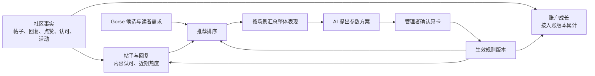

# 社区成长、帖子评分与推荐设计

本方案于 2026-11-07 定案，实施计划见第 7 节。已发布的账户 AI 评估属于待替换链路，实际观察与切换待办另行记录。 [当前工作记录](../../WORK_STATUS.md)

## 1. 产品决定

| 事项 | 已确认决定 |
|---|---|
| 成长与账户 | 社区账户承载等级、领域积累和贡献。荣誉独立展示，银河 ID、组织和 Agent 保留真实归属。等级与荣誉用于展示，后台权限沿原授权办理 |
| 内容与互动 | 帖子和回复支持点赞、取消点赞，一人一票。保留原回复、收藏和举报，原有公开范围适用于评分来源 |
| 社交关系 | 新关注默认公开，用户可改为私人。已有私人关系保持私人，公开列表和计数仅统计公开关系 |
| 账户与帖子 | 内容认可可计入作者对应领域的成长。作者的等级、荣誉和积累不进入帖子排序，点赞票值也不因身份或资历变化 |
| 既有经验 | 有效经验保留原入账分值。规则调整适用于生效后取得的事项。取消、撤回与更正按原记录处理 |
| AI 参数 | 治理宏观调控支持按配置自动分析与拟定参数调整，管理者确认原业务卡后生效。单个账户、帖子和回复的分数由程序计算 |
| 展示与范围 | 前台继续展示成长、荣誉和实际互动计数。内部帖子评分、推荐优先度、计算依据与参数供获授权的管理者查看。消费积分、等级权益解锁及新增公开分数榜不在本轮范围内 |

此前关于逐账户 AI 评估、评价者加权点赞和作者参考进入推荐的设计，由本页决定替代。数据仍通过社区参与、现有管理认可及活动记录形成。私人关注、收藏、私聊、本机资料、举报取证和专用分析数据沿各自已授权用途使用。

## 2. 账户成长按有效取得记录累计

**总经验等于当前有效的已入账经验之和。** 规则依据公开帖子、公开回复、收到的有效点赞、内容认可和活动成果等已有来源。每笔经验记录来源、受益账户、领域、入账值和规则版本。来源归入多个领域时，各相关领域可展示这笔贡献，账户总经验只加一次。等级取总经验达到的最高档，荣誉沿自己的定义、授予与撤回记录独立展示。

程序以业务来源、受益账户和取得事项识别同一笔经验。编辑同一条回复、重复投递、重读或重算沿原记录接续。取消点赞撤去对应原入账值，恢复同一互动按原记录接续。内容撤回时撤去依赖其公开资格的经验和评分信号，历史荣誉是否仍成立由荣誉自己的依据决定。更正领域归属时调整对应领域的归集，原经验值沿用。被举报次数、关注量、浏览量和登录时长不进入此经验规则。

**规则版本按来源实际成立时选定。** 例如一条回复已按 2 分入账，后来规则调到 3 分，这条回复仍计 2 分，撤回也撤去 2 分。迟到处理依据原发生时间及有效版本，避免排队时间改变得分。等级门槛由管理者单独维护，计分参数调整本身不会改写门槛。

现有成长概览用当前规则即时汇总来源。切换时需要根据切换基准下已经有效的来源和分值，固定已计入的经验，记录其切换依据。尚未计入且能够准确归属的历史材料使用单独确定的基线规则，保留原发生时间和基线版本。只有 GUID 的旧内容保留原身份，后续绑定不能推断原账户归属。已有公开关联的旧 GUID 荣誉仍按原资格独立展示。历史承接与切换期间的增量按同一来源接续，原操作和通知保持原记录。

## 3. 内容认可和近期热度分别计算

认可分度量这条内容实际获得的认可。有效点赞按当前关系计数，同一账户对同一内容的有效点赞贡献一个单位。管理认可取明确指向这篇帖子或这条回复且仍有效的记录。同一个认可来源只计一次。授予作者的独立荣誉和活动结果按其所属用途保存。

建议采用易解释的递减累加作为工程默认。下列是算法设计，具体系数和起始值在实施时从已有数据和配置确定。

| 内部结果 | 程序计算 |
|---|---|
| 内容认可 | 点赞系数 × 递减累加(有效点赞数) + 内容认可系数 × 递减累加(有效内容认可数)。默认函数为 `s × ln(1 + 数量 / s)`，正数 `s` 控制递减程度 |
| 近期热度 | 新鲜度系数 × 发布时间衰减 + 讨论系数 × 近期参与贡献之和。讨论按有效回复的参与账户去重，每人取最近一次回复时间。默认按半衰期计算，经过一个配置的时间长度后，相应贡献减半 |

内容认可的来源发生更正时更新对应内容。热度使用计算时点和统一衰减参数，同一数据、时点和参数应得到一致结果。回复活跃代表讨论量，程序保留它与正向认可的区别。帖子与回复各自归集认可。帖子下的回复可以贡献帖子讨论热度，但回复收到的点赞归入那条回复的认可分。

举报沿原治理流程处理。已有治理决定可以改变内容资格，普通用户的单次举报不产生自动扣分。页面显示实际点赞数、回复数及已有明确的认可标识。

## 4. 推荐以需求匹配为主

1. 保留 Gorse 等现有候选来源，按当前内容资格、读者需求、主题及负反馈裁剪。候选原顺序是现有匹配依据。
2. 社区参考启用时，程序读取候选帖或回复的内容认可。仅在使用场景需要时加入近期热度，采用可控幅度的辅助重排。
3. 保留现有去重及集中控制，返回前复核内容的当前版本和可读范围。显式最新按时间，搜索按其查询相关性，继续尊重读者选定的排序方式。

推荐融合可沿用已有倒数排名思路。工程默认使用原候选名次产生匹配项，在同一需求范围中按认可和适用的热度生成辅助名次项。计算形式为 `匹配系数 /（平滑参数 + 原名次）+ 限幅后的内容辅助项`。辅助项由认可和热度的加权倒数名次组成。零有效信号的项贡献为零，同值并列，同分保留原候选顺序。程序限制社区信号造成的名次移动幅度，避免把相邻名次当作相同相关性。具体融合系数、平滑参数和移动上限由实施时的配置确定。

输入取内容的独立认可和近期活跃，不读取作者经验、等级、荣誉或旧 AI 评估结果。同一点赞可增加作者积累，同时作为该内容的一次认可，推荐只消费后者。Gorse 仍接收真实的互动关系及类型化取消，迟到投递服从该关系的最新修订。公开返回内容及必要的通用推荐理由，采用的规则版本供管理端定位。实际曝光按网页真实展示统计。

## 5. 社区参数与治理接线

社区计分与推荐参数的调整归入治理宏观调控，复用工作台、可配置自动运行和业务确认卡。AI 使用业务授权范围内的整体统计，例如类别曝光集中度、认可分布、近期讨论、新内容展示及读者负反馈。工具合同面向统一规则、数值参数和汇总统计。 [治理宏观调控与确认流程](../product/admin.md#宏观调控与策略调整)

| 参数范围 | AI 可以提出的调整 |
|---|---|
| 账户成长 | 已定义且获准计分的行为各给多少经验。采用后影响新取得事项 |
| 帖子评分 | 有效点赞、内容认可和近期讨论的系数，互动增量递减程度及热度衰减时间 |
| 推荐排序 | 需求匹配、认可和时效的融合系数、平滑参数及辅助重排幅度。在既有相关性及资格边界内生效 |

计分来源及取得条件、等级门槛、荣誉、治理处置、账户身份与访问权限分别由所属业务和管理入口决定。以上参数只在实际支持的全站、领域或类别范围内采用，同一输入在一个计算用途下只匹配一份有效规则。原业务卡确认后，由所属配置入口应用该范围和版本的调整。恢复旧参数也形成一个配置版本，成长记录按各自的入账版本计算。

程序可以用同一份已有样本比较新旧规则产生的变化，供管理者查看。样本不足时明确可比较范围。预测影响与上线后的真实观察分别记录，后者以实际展示和反馈为依据。单个帖子或账户的申诉通过原内容、互动或管理记录更正，由程序更新受影响结果。

## 6. 实现归属与切换

- **现有事实与读取。** 社区模块负责帖子、回复和互动，账户模块负责关系可见性。成长模块复用原来源、成长规则、认可和荣誉，集中处理经验入账、内容评分和管理解释。前台读统一结果并沿原事件做局部更新。 [成长模块](../../go/internal/communitygrowth)、[互动](../../go/internal/community/reactions.go)、[关注](../../go/internal/accountsocial/follows.go)
- **推荐与配置。** Discovery 读取程序生成的内容信号，在现有候选之后按策略重排。后台复用规则和推荐配置入口，提供拟改范围、参数差异、采用状态及原操作结果。AI 复用现有后台分析与策略提议能力，授权落在社区参数业务工具。 [推荐融合](../../go/internal/discovery/community-ranking.go)、[AI 运行机制](agent-runtime.md)
- **事务和派生。** PostgreSQL 保存来源修订、计分所用版本及必要结果。写入成功后，复用现有 Worker 合并受影响对象的更新。相同来源重复到达只接续一次，过时结果不能覆盖新修订。推荐请求读取当前可用结果，辅助信号缺失时保留原候选顺序。 [API 装配](../../go/cmd/galaxy-api/community-growth.go)、[Worker 装配](../../go/internal/workerconfig/community-growth.go)
- **旧链路退出。** 实施时把逐对象评估的配置、任务生成、模型保存工具和推荐消费一并退出运行主路径。既有任务、结果和回执继续可追溯，旧模型结果与新的程序分数分别识别。旧接口、任务状态、配置开关和待处理工作按实际消费者及切换时状态承接，具体线上操作属于后续实施。当前源码仍包含旧评估接口与管理入口，其合同以[现有接口说明](interfaces.md)为准。

## 7. 实施计划

按下表推进。前三批可以在共同的数据与配置合同确定后并行开发，部署采用按依赖顺序进行。每批的完成条件用于集中验证正常使用路径。

| 批次 | 实施内容与归属 | 可观察的完成条件 |
|---|---|---|
| 1. 成长入账与历史承接 | `communitygrowth` 增量迁移保存每笔经验的来源、原值、资格、适用规则及修订。接通发布、互动、认可、撤回与历史补算。人物页和管理端读同一份入账结果 | 同一批有效来源切换前后经验一致。调值前后的两笔回复各按自身版本入账，撤回前一笔按原值冲正。重复或迟到投递只接续原记录 |
| 2. 内容评分与推荐 | `communitygrowth` 按帖子和回复归集认可及近期活动，`discovery` 接新版内容信号，在既有候选中有限重排。确认当前对象资格、信号版本和推荐回退，保留 Gorse 反馈接线 | 点赞、取消、回复和撤回会更新正确的内容信号。作者等级变化对排名和票值无影响。开关关闭或整组缺少有效信号时，保持原推荐路径。显式最新、搜索和原资格裁剪按各自合同工作 |
| 3. 治理提案与确认 | 治理块接原工作台、自动运行与待办，提供汇总统计和参数提案工具。新增适用的参数业务卡并接真实配置写入、版本与回执 | 工作台交办及一次正常配置触发均能准备原业务卡。管理者可从治理或工作台确认同一卡，读到实际采用版本。并发修改、重复确认、拒绝及权限撤销均有对应结果 |
| 4. 切换、观察与收束 | 在兼容部署就绪后采用经验账和新版推荐消费者，退役旧逐对象 AI 评估。更新文档中的接口和运行说明 | 切换后既有经验、互动、荣誉及原回执可查。旧评估停止产生任务和评分。新版正常流程以及回退后的经验一致性通过必要检查 |

### 7.1 先承接经验，再切换读取

1. 核对实际已采用的成长规则、有效来源、读取资格、旧评估状态与推荐开关。以增量迁移准备入账记录及回填进度，先部署能兼容新旧记录的 API 和 Worker。
2. 固定迁移基准下旧查询实际计入的来源及分值，记录基准版本。未入账的合格旧材料使用单独的历史基线。批量回填期间沿现有来源事务和待处理机制记录增量，按来源修订追平。新的有效事项按实际发生时的规则版本入账。历史与增量按同一来源、受益账户和取得事项接续为一笔经验。
3. 回填期间旧规则若有调整，重取受影响的基准分值。最终切换时短暂协调计分规则发布和来源更新，核对同一批来源的已计入经验、领域归属和原资格，追平最后的新增及撤销，再按同一个生效边界切换读取和后续计分。无从证明曾经入账的金额以本次核定的迁移基线记载。资格变化造成的差异单独归因。

回填未达到切换条件时，既有读取继续服务，进度可接续。切换后的应用回退使用能读已入账经验的兼容版本。恢复原计分参数只影响随后取得的事项。

增量迁移为 schema 149。API、Worker 与迁移工具更新并完成补算后，使用维护连接执行 `galaxy-migrate community-growth-activate --endpoint <GALAXY_ENDPOINT>`。迁移工具在同一事务固化旧计分、切换成长读取并封存旧评估。回填未完成或仍有来源变更待处理时，命令返回待补齐状态，可在来源追平后再次执行。存量撤回事项缺少原计分记录时，恢复按已固定的迁移基线办理。

### 7.2 内容信号的版本与回退

内容变化沿已有互动、认可及公开资格的来源更新接线。缓存保存可复用的事实或带版本的派生结果，热度以明确的计算时点和当前生效规则求值。调参后用同一版本计算一组候选，未更新的旧派生结果由当前规则重算或视为该项缺失。

首批接入保留原候选和开关边界。旧社区参考关闭时，新版按关闭状态切换。整组没有可用辅助信号时直接回退原顺序，部分候选没有某项信号时该项贡献为零。推荐需要撤回新版辅助时关闭相应辅助配置，账户经验与内容事实继续沿各自来源保存。现有作者参考或评价者倍率参数只作为旧版本记录保存，新版配置以匹配、认可和热度各自的含义采用。

### 7.3 按原业务卡采用参数

现有普通策略和推荐方向动作提供确认卡、执行及回执机制。社区经验、热度和推荐融合参数仍需各自的配置处理器接线。治理块聚合原提案、待办及结果，生效值由各自业务模块维护。

1. 后台按工作台交办或已配置自动运行读取汇总数据，拟定有明确作用域、基准版本、前后值和预计影响的业务卡。单张卡以一个可完整采用的配置范围为单位。同一范围的提案修订沿该事项接续，确认针对当前可审阅的卡版本。
2. 确认运行计划授权分析和准备业务卡。管理者确认具体业务卡时，服务端核对当前配置权限、卡的作用域和基准版本，再调用原业务入口应用。社区参数采用以该次人工确认为准。普通策略自动维护和长期运行授权按各自已批准范围执行。
3. 采用操作与配置变更按现有事务和回执语义办理。重复提交查询原结果，配置版本变化时重新准备可审阅差异。预计影响来自可用样本，实际采用和后续观察分别记录。规则生效后，成长按取得时间选择版本，评分与排序按当前生效规则计算。

### 7.4 退役与上线验收

退役旧评估前记录其实际队列、任务绑定、结果、失败及回执。现有评估配置保存会重置计算范围，应使用针对退役的切换处理，保留原状态与关联。先使停止产生新任务、领取和保存结果的条件在服务端统一生效，再处置原在办任务。迟到回写按退役后的资格处理。历史结果通过适用权限继续查阅，旧计算工具和推荐消费者在确认退出运行路径后收束。

发布前用隔离环境贯通已有来源、规则调值、取消恢复、失去资格、混合候选、自动产生卡和人工确认。重点检查两类并发边界。来源在回填过程中发生撤回时以最新修订为准。后台在确认前修改规则时，该卡按版本冲突返回，原配置值保持可追溯。完成实际切换后核对真实页面、任务和业务回执，以及新排序采用版本和旧任务写入停止状态。实施及切换结果集中记录。 [当前工作记录](../../WORK_STATUS.md)

## 8. 设计参考

Discourse 分开实现用户参与规则和帖子信号汇总。Apache Answer 与 NodeBB 的互动实现展示了原关系、计数与取消的接续。银河沿用现有互动与治理入口。 [Discourse 参与规则](https://github.com/discourse/discourse/blob/main/app/models/trust_level3_requirements.rb)、[帖子计算](https://github.com/discourse/discourse/blob/main/lib/score_calculator.rb)、[Apache Answer 投票](https://github.com/apache/answer/blob/6744295fa888e0621fc9f9a8ace04f1a4daf8554/internal/service/content/vote_service.go)、[NodeBB 投票](https://github.com/NodeBB/NodeBB/blob/2f5e2f04508a54e7ad329ad4c881a98a036c808f/src/posts/votes.js)

Hacker News 将账户 karma 与作者内容排序区分，Lemmy 分开处理帖子投票、活跃及时间衰减。Community Notes 的作者与评价者计算建立在其专门评价数据之上，供比较不同对象的职责。 [Hacker News FAQ](https://news.ycombinator.com/newsfaq.html)、[Lemmy 排序](https://join-lemmy.org/docs/contributors/07-ranking-algo.html)、[Community Notes 计算](https://github.com/twitter/communitynotes/blob/main/scoring/src/scoring/helpfulness_scores.py)

Gorse 提供候选融合和评估机制。Optuna 将调参建立在明确的评价目标上，供本方案的参数比较参考。 [Gorse 管线](https://gorse.io/docs/concepts/pipeline)、[Gorse 评估](https://gorse.io/docs/concepts/evaluation)、[Optuna 参数评估](https://optuna.readthedocs.io/en/stable/tutorial/10_key_features/001_first.html)
