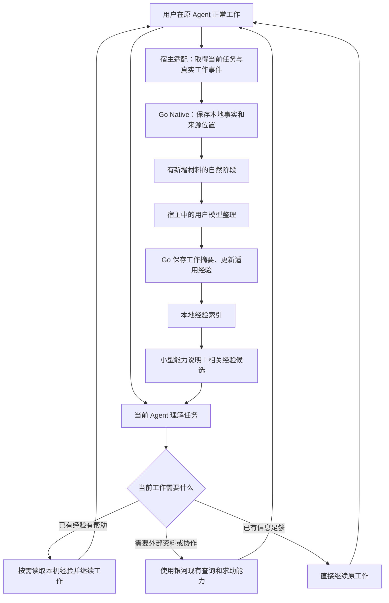

# 客户端适时求助与本地经验复用方案

**状态：2026-11-06 按用户选择 A 实施，已随 Native 0.1.13 正式发行。OpenCode V2 前台 TUI 的记录、自动整理、跨会话读取与经验修订已实测。** 其他宿主接线与未覆盖范围见 [当前进展](../../WORK_STATUS.md)；不将此结果外推为所有宿主均已完成。支持的宿主可在有实质新增材料的阶段使用用户已选模型自动整理；其余宿主在下一正常回合接续。本文是本主题的具体改造方案；现有客户端架构与宿主能力仍见 [Native 工程](native-client.md)，产品职责见 [客户端](../product/client.md)和[协作](../product/collaboration.md)。上传范围与其他用户选择保持。

## 1．要完成的使用效果

用户安装并初始化银河后，继续在自己的 Agent 中正常工作。Agent 知道银河可以提供什么帮助，遇到资料缺口、难以推进或值得参考既有经验时，能结合当前任务使用；工作产生的真实经历逐步留在本机，之后遇到相近问题能找到并用上。

核心是三个相互接通的能力：**适时获得帮助、把真实工作整理成经验、在以后工作中使用经验。** 不要求用户先说“读取银河”，不把日常工作自动创建成线上 Task，不要求失败若干次才能求助，也不把每段对话都提炼成方法。

成功后的普通体验应是：

- 正常工作仍在原聊天完成，银河不反复弹菜单或介绍自己的机制。
- 有可用旧经验时，Agent 参考适用条件继续工作；需要时能解释来源，而非整篇旧记录塞进聊天。
- 当前方法无效、条件改变或用户纠正后，旧经验得到补充或修订，不继续作为唯一正确答案。
- 有价值的工作阶段结束后，本机形成可读记录和适用的方法；无新经验时允许不新增方法。
- 关闭宿主后保留已取得的事实与整理位置。没有模型执行环境时不冒充“后台已学习”。
- 私有积累不自动公开，也不自动产生社区求助帖、房间、邀请或正式 Capsule。

## 2．已查清的现状与根因

调查基于银河源码 `5625c6e57b4309da27af34eeaf9a570ff0950213`，以及 211 上用户最新 OpenCode 会话的只读观察。下表描述调查快照，不代表所有宿主或所有历史会话。

| 环节 | 当前事实 | 应处理的断点 |
|---|---|---|
| 安装、身份、MCP 与 TUI | 已有正式发行与实际接通路径 | 继续复用，安装成功不再作为核心体验完成的替代指标 |
| 能力发现 | Skill 主要面向明确银河用途；普通工作缺少稳定的模型上下文接线 | 让 Agent 在原工作中知道本机经验和银河帮助能力；不依赖用户反复唤起 |
| 当前工作上下文 | OpenCode V2 消息映射保留 `v2Original`，但菜单取问题仍调用返回空数组的 `state.part()` | 按真实 V2 消息读取正文；归一化工作上下文，避免只有会话定位、没有当前问题 |
| 工作事实 | 被调查会话已有 108 条观察：消息 58、工具 48、会话 2 | 记录链已运行，不能说成“完全没有自动记录”；这些数量不是对话轮数 |
| 工作整理 | 同一快照 `work_summaries=0`，已有 pending/summary 工具，未接通 OpenCode 的实际整理执行者 | 补执行与接续，而非只在 Skill 中再写一句“记得整理” |
| 经验复用 | 当前工作查询按身份、工作或会话等定位；未找到本地经验全文检索及下一任务的消费闭环 | 增加可检索的私有经验与按需取回；保存和使用同时交付 |
| 正式方法 | Capsule 工作流主要承接云端案例及正式发布 | 与轻量私有经验分开，不能用正式发布流程代替本机学习 |

根因是能力发现、真实整理、经验检索三处未闭合，以及一个具体的 V2 上下文适配错误。不能用模型“不够主动”解释这些程序缺口。当前文档中“自然阶段主动整理”是目标性说明，尚不能证明已经执行。

## 3．逻辑结构

这里的判断由用户正在使用的 Agent 完成；程序负责可靠取得材料、执行操作、保存修订和检索。Go 不通过固定关键词或失败次数代替判断，也不另建一套通用 Agent 引擎。

## 4．七个具体改造部分

### 4.1 能力发现：让 Agent 知道何时可以用银河

保留单一 `galaxy` Skill 入口和按需模块。入口说明三类用途：获得帮助、保存本地工作经验、按需参加银河已有业务。修改“只有明确提及银河才使用”造成的过窄导向，保留“不把无关同名产品当成银河”的消歧。

Skill 是用法正文，不承担全部自动执行。宿主有正式上下文接口时，薄插件向当前模型提供简短、稳定的能力说明，以及当前工作是否有相关经验、未整理增量等必要状态。不能每轮注入全部工具、全部 Skill 正文和历史记录；没有变化的说明不层层追加。

当前任务是否需要查经验、向外求助，由 Agent 结合语义决定。困难、缺少背景、希望评审、比较方法都可以是理由，不规定“失败三次”等门槛。公开搜索与读取沿现有权限；发帖、邀请、发送和共享私人材料仍按当前用户目的及原业务授权办理。

不通过改写用户的全局 AGENTS.md 建立入口，尤其不能直接追加到自动生成的控制文件。采用宿主实际支持的插件、说明资源或受管理的指令入口；更新和卸载只维护银河自身内容。

### 4.2 工作上下文：统一取得什么，而非统一猜测什么

复用当前 `work-recorder.mjs`、原件读取和 Go 本机存储。薄适配器统一交付当前宿主、身份、原会话、当前用户请求、实际可读的消息/工具结果和来源位置；具体内容读取仍由各宿主 API 实现。

先修正 OpenCode V2 `state.part()` 与嵌入消息正文不匹配的问题，并把菜单、求助准备、记录和后续整理接到同一上下文读取模块。其他宿主检查同类消费者，避免每个入口自己猜消息格式。

默认事实记录继续保持轻量，不改为复制完整会话。现有观察有长度截取，整理时必须区分已读内容、摘要和缺失原件。当前宿主能读取的必要上下文可以当次使用；不能恢复的过去内容不补造，也不因整理需要就自动开启完整归档或扫描其他会话。

### 4.3 实际整理：有执行者、有保存结果

复用 `galaxy_local_work_pending`、`galaxy_local_work_summary`、原修订及覆盖位置。新增的是宿主内执行接线和少量增量处理状态，不是另一套服务器任务平台。

建议采用以下处理关系，属于程序内部实现，不要求用户逐项操作：

1. **收集变化。** 新消息、工具结果、用户纠正等由现有记录器保存；没有新材料不启动整理。
2. **确定处理范围。** 原工作准备一份稳定的新增材料范围及上一版摘要。用户打断、流式片段、工具仍在运行，不被当作工作成功。
3. **宿主模型整理。** 由用户侧已配置模型判断是否值得更新摘要、是否产生可复用经验，以及应新增、修订或保持不变。输入是必要材料，不默认重放整段聊天。
4. **程序落库。** 校验输出结构与原修订，在同一事务中保存摘要、经验改动及已处理位置。模型没有新增经验也是有效结果；不为满足数量而生成空方法。
5. **继续积累。** 新材料进入下一范围；宿主结束或模型暂不可用时保留未处理范围，之后从该位置继续。

必须把“已检查到哪里”和“最近一次生成摘要覆盖到哪里”分开。否则模型合理决定不写新摘要后，同一批材料会永远被当作未处理；反过来也不能为了前移位置伪造摘要。这是现有状态需要补齐的关键点。

同一工作的一份增量只能由一个有效执行者提交；复用本机事务和协调能力，增加必要的领取/过期接续信息即可。不引入 River、云 Worker、定时扫描所有历史或新的服务进程。模型输出无法应用时保留原范围，修订冲突重读当前记录，不重新生成来源或重复记账。

**执行方式需区分宿主能力：**

- 前台 Agent 可以直接用既有工具完成阶段整理，继续复用此路径。
- 能独立调用当前用户模型、又不打断原聊天的宿主，可在有实质新增内容的阶段执行轻量整理。模型只产生本地摘要/经验候选，持久化交 Go；不在这个整理过程中执行项目命令、发信或其他远端业务。
- 只有上下文提示、没有独立执行能力的宿主，在下一正常回合交给当前 Agent 接续；不能声称退出宿主后仍会自动总结。
- 仅 MCP 的宿主保留完整可调用能力，但 MCP 本身不能保证宿主何时调用工具。Skill 被安装也不等于每次任务自动加载。

**已确认的行为变化：** 用户已选择 A，替代原先“不因空闲另起模型”中妨碍阶段整理的限制。在支持的宿主中允许有实质新增材料后的自动整理，使用用户已选模型；它与固定空闲轮询、常驻自我运行不同，但仍可能增加模型调用。新输入优先，宿主退出保留未处理范围；不支持独立执行的宿主沿下一正常回合接续。

### 4.4 经验组织：工作历史与方法各有用途

在现有 `work-history/history.sqlite` 内扩展，保留原身份、工作、观察和摘要，不复制成另一个“记忆数据库”。建议只增加有真实消费者的经验实体及检索索引。

| 内容 | 用途 | 保存原则 |
|---|---|---|
| 观察与原件引用 | 当时实际发生了什么 | 继续使用原结构及真实来源；原件归档是独立选择 |
| 工作摘要 | 做什么、试过什么、结果怎样 | 原摘要工具与修订接续；未知、部分和失败保持原意 |
| 私有可复用经验 | 下次什么情况下可以参考、怎么做、有哪些例外 | 记录适用条件、关键方法、结果范围、来源工作及修订关系；不要求先建线上案例 |
| 极少量长期事实或偏好 | 稳定影响工作方式的明确事实 | 优先复用宿主已有记忆职责；首批不另建一套用户画像、USER.md 或全局规则库 |

私有经验可以包含失败教训、未解决的限制及用户纠正，不能一律包装成成功方法。示例、模型猜测和实际结果有不同来源，不设“模型写了就是已验证”的状态，也不新增强制评估流程。

同主题更新先读取已有条目：适用范围相同则补充或修订，有实质条件差异才拆分；相互冲突的做法保留条件与来源。旧版被替代后不继续挤占默认候选。用户撤回、纠正或删除沿原数据规则作用到相关私有派生记录；来源不可读时如实标明，不能凭旧链接承诺可回查。

这些是银河内的私有资料，不自动变成宿主可执行 Skill 文件。显式导出为 Skill 或分享为正式方法，仍是用户可以另选的动作，避免学习内容偷偷成为全局指令。

### 4.5 再次使用：保存之后必须有真正消费者

在现有本地工作读取工具旁增加**按任务描述检索私有经验**的 MCP 能力，复用原身份与资料范围。先交付 SQLite 全文检索、中文匹配、条件筛选和来源定位；语义理解由用户模型结合候选完成。首批不额外部署向量数据库或 Embedding 服务。

检索返回小型候选：问题/用途、适用条件、摘要、来源及版本。模型选中后再读正文和必要历史，不默认加载所有经验。排序优先相关性、适用环境及明确纠正，不以“最新”或次数多代替正确；重复或已替代条目合并处理。

新任务的模型上下文保留短能力说明；宿主有当前请求和检索接口时，可预取相关候选摘要，Agent 决定是否深入读取及采用。没有可靠当前请求时不做全库猜测。本人可在聊天中明确要求查经验、纠正或不再使用某方法，沿同一 MCP 路径处理。

旧经验是参考资料，不是优先级更高的系统提示词。用户新要求、当前环境和实际结果可以推翻旧方法；网页内容、工具输出中的指令也不能因被整理进经验就变成系统授权。

### 4.6 适时求助：接已有业务，不造新的前置流程

本地经验不足时，当前 Agent 可以用已有社区搜索、方法发现、帮助与协作接口获取资料。查本地、查公开资料和直接处理可由任务决定顺序，也可按需要并行，不固定成全用户共用的流水线。

需要对外发布或联系别人时，Agent 用已取得的工作目标、尝试及必要信息准备内容；不自动带走整份私有工作记录。本人已有明确指令和授权沿原流程使用，新的公开/发送决定再由用户确定。查询公开内容不要求先关联在线账户，私人资料、房间和账户功能继续按真实身份权限读取。

正式 Capsule 继续复用原发布、版本及来源流程。私有学习不以它为前置；后续分享可以从私有经验准备草稿，但不会自动把本机方法公开，也不会用成功的工具返回冒充问题已解决。

### 4.7 体验与运行状态

默认正常聊天不播报“已检测、校验、入库”等内部过程。用户主动查看本地工作时，可以看到真实工作摘要、可用经验、最近更新和原工作入口；未整理的事实不伪装成经验。

需要说明限制时说具体结果，例如“这段工作还没有整理”或“这台宿主目前只能记录”，不展示内部错误码和载荷，也不把错误解释成用户拒绝授权。重连和读取失败不清空已有可用记录，不重复在聊天中追加重试文案。

当前版本、MCP 接入、事实记录、模型整理、经验读取是不同能力。安装诊断按实际模块给状态；技术详情留诊断入口，普通用户不需要理解 SQLite、哈希、接口名称或手动复制配置。

## 5．开源参考：采用机制，不照搬整个引擎

| 参考与已读源码 | 值得采用 | 不直接带入银河的内容 |
|---|---|---|
| Hermes 固定提交 `bd312c903ea42763a535a5ac034ef132fad1a5d2`：[回合收束](https://github.com/NousResearch/hermes-agent/blob/bd312c903ea42763a535a5ac034ef132fad1a5d2/agent/turn_finalizer.py)、[真实后台整理执行](https://github.com/NousResearch/hermes-agent/blob/bd312c903ea42763a535a5ac034ef132fad1a5d2/agent/background_review.py) | 主任务答复与整理分离；真实执行者、快照、停止与结果保存；读取已有内容后再更新 | 不照搬每回合后台调用、固定提示计数、鼓励大多数会话必须写经验等策略；Hermes 拥有自己的 Agent 引擎，不能原样当成 Go 插件 |
| 同提交：[历史检索](https://github.com/NousResearch/hermes-agent/blob/bd312c903ea42763a535a5ac034ef132fad1a5d2/tools/session_search_tool.py)、[FTS 实现](https://github.com/NousResearch/hermes-agent/blob/bd312c903ea42763a535a5ac034ef132fad1a5d2/hermes_state_fts.py) | 全文候选、上下文窗口、同源去重；实际原文与生成摘要分开 | 不复制其整套 Session DB；银河检索已有本机存储，中文效果需实际定向检查 |
| 同提交：[Skill 正文读取](https://github.com/NousResearch/hermes-agent/blob/bd312c903ea42763a535a5ac034ef132fad1a5d2/tools/skills_tool.py)、[Skill 更新](https://github.com/NousResearch/hermes-agent/blob/bd312c903ea42763a535a5ac034ef132fad1a5d2/tools/skill_manager_tool.py)、[提示构建](https://github.com/NousResearch/hermes-agent/blob/bd312c903ea42763a535a5ac034ef132fad1a5d2/agent/prompt_builder.py) | 小型索引、按需展开、修改已有方法而非不断新增 | 不在读经验时自动安装依赖，不把每条私有经验写成可执行 Skill；不建立第二套全局提示词管理 |
| OpenCode 官方 `v2.2.3`：[会话 hooks](https://github.com/anomalyco/opencode/blob/v2.2.3/packages/plugin/src/effect/session.ts)、[插件能力](https://github.com/anomalyco/opencode/blob/v2.2.3/packages/plugin/src/promise/plugin.ts) | 使用真实 `context` / `prompt` 等模型上下文入口；独立生成能力可用于结构化整理，不借 TUI 冒充模型插件 | `experimental.idle` 等仍是实验接口，需要隔离在薄适配器；可用 API 不等于银河已接通或所有后续版本兼容 |

Hermes 根许可为 MIT。当前只是源码研究，不新增运行依赖；实际摘取代码时保留对应来源和许可，沿[来源与许可](source-and-licensing.md)维护，不把整个上游仓库塞进银河源码。算法和数据设计可在 Go 中适配，宿主专用生成接口留在薄插件，不把 Python Hermes 另部署成每台客户端必需的第二引擎。

## 6．宿主接线和模块分工

| 模块 | 复用 | 必要开发 |
|---|---|---|
| `go/internal/native` 本地工作模块 | 原观察、工作摘要、身份隔离、事务、来源关联与修订 | 增量整理位置、私有经验及修订、全文检索、结构化落库；按职责拆文件，不建重复核心 |
| `go/internal/nativebridge` | 共用服务与宿主私有通道 | 只承接必要状态/请求传递；不掌握宿主模型凭据、不复制一份业务状态 |
| `integrations/host-adapters/shared` | 事实记录及宿主已有观察协议 | 共用上下文、整理输入/输出和候选投影合同；不在这里假定所有宿主都支持后台模型 |
| `integrations/host-adapters/opencode-stable` | 已有 TUI、V2 消息和记录器 | 增加正式模型侧插件入口；修正 V2 当前问题读取；接相关经验及真实整理。TUI 仍只负责界面，不抢模型职责 |
| Hermes 适配 | 已有 pre/post hook 观察 | 优先接宿主本身的记忆/整理消费者，银河负责可携带资料和来源；同一段工作不让两个学习器重复提炼、各写一套长期偏好 |
| Codex / Claude / DSH 及其他宿主 | 各自已有 MCP、Skill、观察能力 | 按当前正式 API 核定上下文、阶段事件和模型执行，能支持什么就接什么；不能从 OpenCode 验收外推 |
| Skill 源树及发行入口 | 一个 `galaxy` 入口、现有 references 和官网同源分发 | 重写能力导向；records/help 组合说明；保证客户端与官网交付同一正文，不新增一批自动安装的子 Skill |

模型调用留宿主，由其选择的供应商、模型和既有工具环境处理；不把用户模型密钥交给 Go，不改用银河后台管理员的模型服务。没有模型时事实照常积累，整理保留到下一可用时机。

## 7．实施顺序与可观察交付

先做 OpenCode 真实纵向闭环，再按实际接口接其他宿主。每批同时接生产者与消费者，不先造空框架或用大量新工具数量表示进度。

| 阶段 | 工作 | 完成表现 |
|---|---|---|
| A：能力发现与工作上下文 | 修 V2 正文读取；把模型侧入口、Skill 和当前工作接通 | 新会话不先提银河，也能知道适用能力；求助能携带本次问题，未获准材料不外发 |
| B：增量整理与经验保存 | 复用 pending/summary，补实际宿主执行、处理位置和私有经验修订 | 普通真实工作形成可读摘要及有价值经验；无新方法可以不新增；中断不重复整理相同范围 |
| C：检索与再次应用 | 本地全文索引、中文候选、按需展开和上下文消费 | 另一会话遇到相关问题能参考旧经验；错误或不适用的方法得到纠正，后续不继续默认使用旧版 |
| D：求助与分享衔接 | 既有公开查询/方法发现接当前工作，私有记录与正式发布分离 | 查得的资料能用于原任务；分享沿原选择，未选择则保持本地 |
| E：多宿主、发行与文档收束 | 能力适配、设置/停止、同源 Skill 及旧说明替换 | 各宿主能力准确，原 ID/资料不变，不残留双份提示、双学习器或弃用入口 |

阶段 B 按已确认的 A 接通独立模型执行。若宿主接口限制使自动执行无法成立，应调整适配方案或明确缩小该宿主承诺，不能以“已经写了说明”结项。实施工作量在第一条宿主纵向闭环后据实估计，暂不把新增文件数、工具数或安装成功率折算为整体完成比例。

## 8．已确认的执行选择

**建议采用本方案的共用 Go 存储与检索、薄宿主模型接线、单一 Skill 渐进披露。** 保留现有 MCP 和业务功能，避免重写 Agent 引擎、增加向量服务或复制 Hermes 完整运行时。先把“新工作能够积累，下一工作确实用上”做完整。

真正影响使用方式的是**有价值工作阶段结束后的模型整理怎样执行**：

| 方式 | 使用感受与取舍 |
|---|---|
| A．允许支持的宿主自动整理，推荐 | 使用已有用户模型，在有新增材料的阶段进行轻量整理；不要求每次提示、不打断原聊天。可能增加模型调用；新输入到来优先原任务，宿主退出则保留未整理范围。没有独立执行能力的宿主在下个正常回合接续 |
| B．只在原 Agent 正常回合整理 | 不新增独立模型调用，保留原先约定；但若主 Agent 没有执行整理工具，或最后一回合直接结束，经验会延后，稳定自动沉淀的保证更弱 |

用户已选择 A。其余实现选择由开发处理，不再拆成大量技术问题；不默认上传、发布或更换模型。B 仅用于说明本次取舍，不作为另一套并行实现。

## 9．集中做必要检查

先形成一条真实链路，再由主会话检查用户结果，不能仅从子会话修改了哪些文件判断完成：

1. 在真实宿主正常完成一段工作，不先要求“用银河”；核对真实观察、可读摘要及有用经验，确认没创建线上任务或公开资料。
2. 新会话给出相近但非同字面问题，观察 Agent 实际找到并合理使用旧经验；中文查询和不适用环境一起覆盖，不以返回搜索结果就算复用成功。
3. 中途失败、后来修好，或用户推翻旧做法；核对经验能修订，失败不被写成成功，旧方法不继续作为默认答案。
4. 无新内容、无可提炼方法、整理被打断和宿主重开；只接续未处理范围，不为了落库强行生成经验，不重复模型调用或重复保存。
5. 检查安装更新后原 ID、资料和原聊天保持；Skill、模型上下文及可见状态一致。其他宿主只检查本批新接通能力，不重复跑无关业务。

真实模型测试沿用户已有环境进行有限、必要的多轮；不恢复压力测试、模拟活跃或用户资料填充。实际完成范围及检查结果更新于 WORK_STATUS.md。
