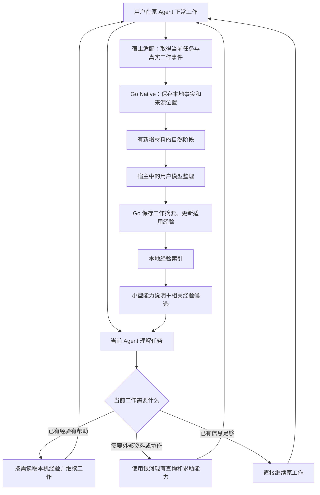

# 本机经验整理与复用

本机经验由 Go 保存，当前宿主中用户选择的模型负责整理和采用。本文集中维护增量处理、经验语境、检索及宿主接线；安装、IPC、身份、归档和发行见 [Native 工程](native-client.md)。公开用法见 [客户端](../product/client.md)，实际发行及未覆盖范围见 [WORK_STATUS](../../WORK_STATUS.md)。

## 工作与整理的调用关系

这里的判断由用户正在使用的 Agent 完成；程序负责可靠取得材料、执行操作、保存修订和检索。Go 不通过固定关键词或失败次数代替判断，也不另建一套通用 Agent 引擎。

## 运行机制

### 能力发现：让 Agent 知道何时可以用银河

反复尝试仍无法推进时的自然求助是主要用户入口，经验复用和社区参与在此基础上增强帮助能力，产品含义见[范围与职责](../product/overview.md#主要入口与增强关系)。上下文接入应使当前 Agent 能理解实际目标、尝试和受阻原因；是否求助仍由它判断，不另外建立固定失败计数器来代替推理。

保留单一 `galaxy` Skill 入口和按需模块。入口说明三类用途：获得帮助、保存本地工作经验、按需参加银河已有业务。修改“只有明确提及银河才使用”造成的过窄导向，保留“不把无关同名产品当成银河”的消歧。

Skill 是用法正文，不承担全部自动执行。宿主有正式上下文接口时，薄插件向当前模型提供简短、稳定的能力说明，以及当前工作是否有相关经验、未整理增量等必要状态。不能每轮注入全部工具、全部 Skill 正文和历史记录；没有变化的说明不层层追加。

当前任务是否需要查经验、向外求助，由 Agent 结合语义决定。困难、缺少背景、希望评审、比较方法都可以是理由，不规定“失败三次”等门槛。公开搜索与读取沿现有权限；发帖、邀请、发送和共享私人材料仍按当前用户目的及原业务授权办理。

不通过改写用户的全局 AGENTS.md 建立入口，尤其不能直接追加到自动生成的控制文件。采用宿主实际支持的插件、说明资源或受管理的指令入口；更新和卸载只维护银河自身内容。

### 工作上下文：统一取得什么，而非统一猜测什么

复用当前 `work-recorder.mjs`、原件读取和 Go 本机存储。薄适配器按宿主实际接口交付可取得的宿主、原会话、当前请求、消息或工具结果及来源位置；各宿主能取得的内容和覆盖不同，不能把共用合同当成所有宿主均已完整采集。

OpenCode V2 从消息内嵌正文读取当前问题，菜单、求助准备、记录和整理复用相应上下文。宿主消息形状由其薄适配器处理。

默认事实记录继续保持轻量，不改为复制完整会话。现有观察有长度截取，整理时必须区分已读内容、摘要和缺失原件。当前宿主能读取的必要上下文可以当次使用；不能恢复的过去内容不补造，也不因整理需要就自动开启完整归档或扫描其他会话。

### 实际整理：有执行者、有保存结果

复用 `galaxy_local_work_pending`、`galaxy_local_work_summary`、原修订及覆盖位置。增量处理状态由本机核心保存，模型执行交给宿主。

处理关系如下。

1. **收集变化。** 新消息、工具结果、用户纠正等由现有记录器保存；没有新材料不启动整理。
2. **确定处理范围。** 原工作准备一份稳定的新增材料范围及上一版摘要。用户打断、流式片段、工具仍在运行，不被当作工作成功。
3. **宿主模型整理。** 由用户侧已配置模型判断是否值得更新摘要、是否产生可复用经验，以及应新增、修订或保持不变。输入是必要材料，不默认重放整段聊天。
4. **程序落库。** 校验输出结构与原修订，在同一事务中保存摘要、经验改动及已处理位置。模型没有新增经验也是有效结果；不为满足数量而生成空方法。
5. **继续积累。** 新材料进入下一范围；宿主结束或模型暂不可用时保留未处理范围，之后从该位置继续。

必须把“已检查到哪里”和“最近一次生成摘要覆盖到哪里”分开。否则模型合理决定不写新摘要后，同一批材料会永远被当作未处理；反过来也不能为了前移位置伪造摘要。两类位置分别持久保存。

同一工作的一份增量只能由一个有效执行者提交；复用本机事务和协调能力，增加必要的领取/过期接续信息即可。不引入 River、云 Worker、定时扫描所有历史或新的服务进程。模型输出无法应用时保留原范围，修订冲突重读当前记录，不重新生成来源或重复记账。

**执行方式需区分宿主能力：**

- 前台 Agent 可以直接用既有工具完成阶段整理，继续复用此路径。
- 能独立调用当前用户模型、又不打断原聊天的宿主，可在有实质新增内容的阶段执行轻量整理。模型只产生本地摘要/经验候选，持久化交 Go；不在这个整理过程中执行项目命令、发信或其他远端业务。
- 只有上下文提示、没有独立执行能力的宿主，在下一正常回合交给当前 Agent 接续；不能声称退出宿主后仍会自动总结。
- 仅 MCP 的宿主保留完整可调用能力，但 MCP 本身不能保证宿主何时调用工具。Skill 被安装也不等于每次任务自动加载。

**已确认的执行方式。**在支持的宿主中允许有实质新增材料后的自动整理，使用用户已选模型；它与固定空闲轮询、常驻自我运行不同，但仍可能增加模型调用。新输入优先，宿主退出保留未处理范围；不支持独立执行的宿主沿下一正常回合接续。

### 经验组织：工作历史与方法各有用途

在现有 `work-history/history.sqlite` 内扩展，保留原身份、工作、观察和摘要，不复制成另一个“记忆数据库”。经验实体、修订和检索索引由当前本机模块维护。

2026-11-06 用户确认本机经验由模型选择有复用价值的内容保留，并补充明确：不是所有内容都要沉淀，普通日常、重复信息和无价值过程不生成经验；没有值得保留的内容时不写。此前选择 A 的宽松积累指允许有价值的讨论留下，不代表广泛收集或每轮必须生成。保留语境，区分模型建议、用户选择、实际使用与结果，不增加逐条人工审批；这不是完整信任机制的定案，更严格的细节待用户后续说明，当前按已确认范围运行。

| 内容 | 用途 | 保存原则 |
|---|---|---|
| 观察与原件引用 | 当时实际发生了什么 | 继续使用原结构及真实来源；原件归档是独立选择 |
| 工作摘要 | 做什么、试过什么、结果怎样 | 原摘要工具与修订接续；未知、部分和失败保持原意 |
| 私有可复用经验 | 下次什么情况下可以参考、怎么做、有哪些例外 | 记录适用条件、关键方法、结果范围、来源工作及修订关系；不要求先建线上案例 |
| 极少量长期事实或偏好 | 稳定影响工作方式的明确事实 | 优先复用宿主已有记忆职责；首批不另建一套用户画像、USER.md 或全局规则库 |

私有经验可以包含失败教训、未解决的限制、有用讨论及用户纠正，不能一律包装成成功方法。`basis` 用简短文字记录形成依据、提出者、采纳与实际使用情况，随候选、正文和修订一同返回；没有标注的旧记录保持空值。旧客户端未传该字段且内容未变时保留说明，内容变化则不沿用旧依据给新方法背书；原修订保留。该说明本身仍是来源陈述，不是系统认证或信用分。模型建议不自动成为用户规则，重复摘要不成为独立证据；不新增强制评估流程。

同主题更新先读取已有条目：适用范围相同则补充或修订，有实质条件差异才拆分；相互冲突的做法保留条件与来源。旧版被替代后不继续挤占默认候选。用户撤回、纠正或删除沿原数据规则作用到相关私有派生记录；来源不可读时如实标明，不能凭旧链接承诺可回查。

这些是银河内的私有资料，不自动变成宿主可执行 Skill 文件。显式导出为 Skill 或分享为正式方法，仍是用户可以另选的动作，避免学习内容偷偷成为全局指令。

### 再次使用：保存之后必须有真正消费者

`galaxy_local_experience_search/get/upsert` 提供经验检索、完整读取和修订，复用原身份与资料范围。检索使用 SQLite FTS5 trigram／bm25，短查询采用受限回退；语义理解由用户模型结合候选完成。字面不同的相近查询仍可能漏匹配，当前没有向量或 Embedding 服务。

OpenCode V2 预取使用共用查询准备，从整个请求提取有界词面线索，避免将超长正文直接送入 Go 的 2,000 码点查询接口；未形成查询、成功无候选和检索失败分别表达，并按请求代次和经验修订去重。条件是相关性排序线索，不是整句硬过滤；混合短词在候选不足时使用受限回退。该路径不是语义检索，常见词、表达差异及候选窗口仍可能漏掉相关经验；当前 Agent 可自主换词或按需查询，不能把空候选当成经验不存在。FTS 候选召回和模型对已召回候选的理解是两件事。

检索返回小型候选：问题/用途、适用条件、摘要、来源及版本。模型选中后再读正文和必要历史，不默认加载所有经验。检索按词面相关性和条件线索排序，时间用于同等条件下的次序；适用范围、纠正及可靠性仍由当前 Agent 结合正文和来源判断。已退役条目不作为当前候选。

新任务的模型上下文保留短能力说明；宿主有当前请求和检索接口时，可预取相关候选摘要，Agent 决定是否深入读取及采用。没有可靠当前请求时不做全库猜测。本人可在聊天中明确要求查经验、纠正或不再使用某方法，沿同一 MCP 路径处理。

旧经验是参考资料，不是优先级更高的系统提示词。用户新要求、当前环境和实际结果可以推翻旧方法；网页内容、工具输出中的指令也不能因被整理进经验就变成系统授权。

### 适时求助：接已有业务，不造新的前置流程

本地经验不足时，当前 Agent 可以用已有社区搜索、方法发现、帮助与协作接口获取资料。查本地、查公开资料和直接处理可由任务决定顺序，也可按需要并行，不固定成全用户共用的流水线。

需要对外发布时，默认准备有独立页面与进展记录的求助请求，正式承接及关联讨论按需要选择，见[协作合同](../product/collaboration.md#从当前工作获得帮助)。联系别人时，Agent 用已取得的工作目标、尝试及必要信息准备内容；不自动带走整份私有工作记录。本人已有明确指令和授权沿原流程使用，新的公开/发送决定再由用户确定。查询公开内容不要求先关联在线账户，私人资料、房间和账户功能继续按真实身份权限读取。

正式 Capsule 继续复用原发布、版本及来源流程。私有学习不以它为前置；后续分享可以从私有经验准备草稿，但不会自动把本机方法公开，也不会用成功的工具返回冒充问题已解决。

### 体验与运行状态

默认正常聊天不播报“已检测、校验、入库”等内部过程。用户主动查看本地工作时，可以看到真实工作摘要、可用经验、最近更新和原工作入口；未整理的事实不伪装成经验。

需要说明限制时说具体结果，例如“这段工作还没有整理”或“这台宿主目前只能记录”，不展示内部错误码和载荷，也不把错误解释成用户拒绝授权。重连和读取失败不清空已有可用记录，不重复在聊天中追加重试文案。

当前版本、MCP 接入、事实记录、模型整理、经验读取是不同能力。安装诊断按实际模块给状态；技术详情留诊断入口，普通用户不需要理解 SQLite、哈希、接口名称或手动复制配置。

## 开源机制参考

| 参考与已读源码 | 值得采用 | 不直接带入银河的内容 |
|---|---|---|
| Hermes 固定提交 `bd312c903ea42763a535a5ac034ef132fad1a5d2`：[回合收束](https://github.com/NousResearch/hermes-agent/blob/bd312c903ea42763a535a5ac034ef132fad1a5d2/agent/turn_finalizer.py)、[真实后台整理执行](https://github.com/NousResearch/hermes-agent/blob/bd312c903ea42763a535a5ac034ef132fad1a5d2/agent/background_review.py) | 主任务答复与整理分离；真实执行者、快照、停止与结果保存；读取已有内容后再更新 | 不照搬每回合后台调用、固定提示计数、鼓励大多数会话必须写经验等策略；Hermes 拥有自己的 Agent 引擎，不能原样当成 Go 插件 |
| 同提交：[历史检索](https://github.com/NousResearch/hermes-agent/blob/bd312c903ea42763a535a5ac034ef132fad1a5d2/tools/session_search_tool.py)、[FTS 实现](https://github.com/NousResearch/hermes-agent/blob/bd312c903ea42763a535a5ac034ef132fad1a5d2/hermes_state_fts.py) | 全文候选、上下文窗口、同源去重；实际原文与生成摘要分开 | 不复制其整套 Session DB；银河检索已有本机存储，中文效果需实际定向检查 |
| 同提交：[Skill 正文读取](https://github.com/NousResearch/hermes-agent/blob/bd312c903ea42763a535a5ac034ef132fad1a5d2/tools/skills_tool.py)、[Skill 更新](https://github.com/NousResearch/hermes-agent/blob/bd312c903ea42763a535a5ac034ef132fad1a5d2/tools/skill_manager_tool.py)、[提示构建](https://github.com/NousResearch/hermes-agent/blob/bd312c903ea42763a535a5ac034ef132fad1a5d2/agent/prompt_builder.py) | 小型索引、按需展开、修改已有方法而非不断新增 | 不在读经验时自动安装依赖，不把每条私有经验写成可执行 Skill；不建立第二套全局提示词管理 |
| OpenCode 官方 `v2.2.3`：[会话 hooks](https://github.com/anomalyco/opencode/blob/v2.2.3/packages/plugin/src/effect/session.ts)、[插件能力](https://github.com/anomalyco/opencode/blob/v2.2.3/packages/plugin/src/promise/plugin.ts) | 使用真实 `context` / `prompt` 等模型上下文入口；独立生成能力可用于结构化整理，不借 TUI 冒充模型插件 | `experimental.idle` 等仍是实验接口，需要隔离在薄适配器；可用 API 不等于银河已接通或所有后续版本兼容 |

Hermes 根许可为 MIT。当前只是源码研究，不新增运行依赖；实际摘取代码时保留对应来源和许可，沿[来源与许可](source-and-licensing.md)维护，不把整个上游仓库塞进银河源码。算法和数据设计可在 Go 中适配，宿主专用生成接口留在薄插件，不把 Python Hermes 另部署成每台客户端必需的第二引擎。

## 模块与宿主边界

| 模块 | 当前职责与源码 |
|---|---|
| `go/internal/native` | 本机事实、工作摘要、身份隔离和事务；`work-experience*.go` 承接经验、修订与检索，`host-summary*.go` 承接整理结果 |
| `go/internal/nativebridge` | 同用户共用服务和宿主私有通道，不持有宿主模型凭据 |
| `integrations/host-adapters/shared` | `local-work-review.mjs`、记录器与 ingress 共用整理输入、输出、阶段去重和事实投影 |
| `integrations/host-adapters/opencode-stable` | `native-galaxy-v2.server.ts` 与会话适配承接模型上下文和整理；TUI 提供界面，记录器保存宿主事实 |
| 其他宿主适配 | 按宿主正式 MCP、Skill、hook 和模型接口接入；支持范围分别记录，不从 OpenCode 推定全部接通 |
| Skill 源树及发行入口 | 共用一个 `galaxy` 入口与 references，客户端和官网从同源分发 |

模型调用留宿主，由其选择的供应商、模型和既有工具环境处理；不把用户模型密钥交给 Go，不改用银河后台管理员的模型服务。没有模型时事实照常积累，整理保留到下一可用时机。

## 当前接通与限制

本轮源码按[核心求助与协作实施设计](native-client.md#核心求助与协作的实施设计)接入了 OpenCode 有界词面预取及结果分类、各已适配宿主的短能力提示；既有增量记录、模型整理、经验修订与来源继续沿原路径。本地有价值经验的保留不以向外求助或正式 Capsule 为前提。

OpenCode V2 前台 TUI 的记录、阶段整理、跨会话检索和修订已接通。模型侧与 TUI 在同一项目作用域汇合，按原请求代次去重。普通日常、重复内容或没有可复用价值的材料可以返回空结果；未被用户采纳的讨论不得写成已实施或已成功的方法。`basis` 随候选、正文和修订读取，原内容变化时不沿用旧依据。

本地整理与经验读写的接通，不等于“自然受阻 → 发布求助 → 获得人或 Agent 的实际帮助 → 返回原工作”已经完成端到端验收。当前 Skill 和宿主提示提供用途说明；独立请求、参与者查询与可选 A2A 接线的实际工具范围见 Native 工程。`IntegrationCase` 形成的升级草稿仍是本地草稿，不代表已发布请求；不能把缺少端到端证据直接归因为缺少一个硬编码触发器。

无 TUI 的 CLI 自动事实采集尚未接通。Codex、Claude、Hermes、DSH 已有各自的上下文或事实入口，其完整模型流程须按宿主分别核对。已有核心与 MCP 能力不保证每个宿主何时调用整理工具；真实调用和平台覆盖统一记入当前状态。
